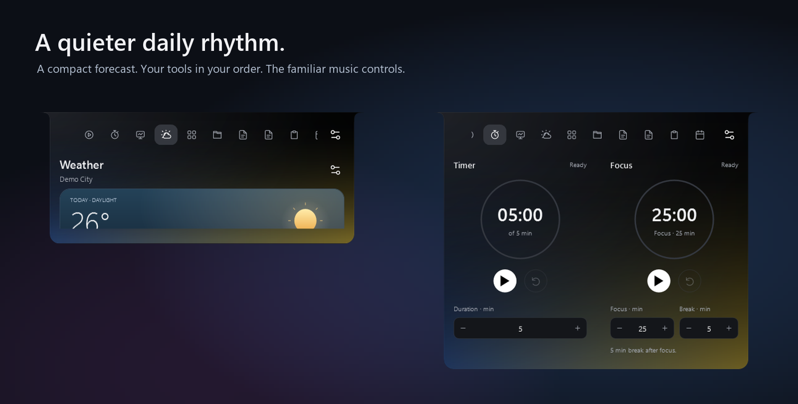
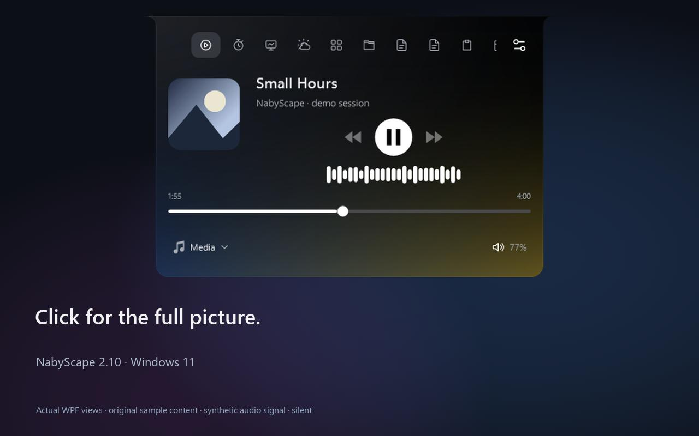
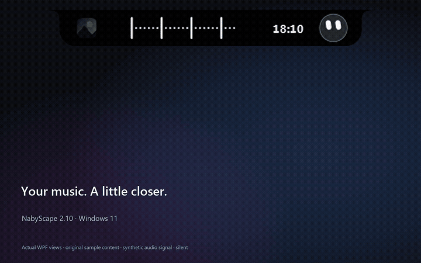

<p align="center"></p>

<h1 align="center">NabyScape</h1>
<p align="center">Music, a little company, and everyday tools.<br>A quiet island for Windows 11. Placed your way.</p>
<p align="center"><a href="https://nabyscape.sigma-bw-0740.chatgpt.site/">Website</a> · <a href="https://github.com/BillyNabil/nabyscape/releases/tag/v2.10.0">Download v2.10.0</a> · <a href="docs/guide.md">User guide</a> · <a href="https://github.com/BillyNabil/nabyscape/releases/download/v2.10.0/NabyScape-demo.mp4">Watch the demo</a></p>
<p align="center"> <a href="LICENSE"></a> <a href="https://github.com/BillyNabil/nabyscape/releases/latest"></a></p>

**New in 2.10:** precise dock placement, compact Weather, drag-and-drop widget order, every active widget in hover, and smooth monitor following. Includes the ambient, Settings and efficiency improvements since 2.7.8. [Release notes](docs/releases/v2.10.0.md)

## A little light. A little more within reach.



<table>
<tr><th align="left">Placed your way</th><th align="left">Your tools, in order</th></tr>
<tr><td width="50%"></td><td width="50%"></td></tr>
<tr><td>Drag the dock on a screen map. Enter pixels or percent, use the sliders, or choose <strong>Center</strong>. Closed, hover and open sizes stay independent.</td><td>Drag a grip to arrange widgets. Hover follows active widgets and their order. Prefer a different hover deck? Turn off the linked order.</td></tr>
</table>

- **A compact forecast.** An illustrated sky, hourly temperatures, rain, humidity and wind in a small card. Choose a city; device location is never requested. Data from [Open-Meteo](https://open-meteo.com/).
- **Light that follows the cover.** One color or a blend, custom colors, intensity, direction, reach and softness. Measured audio can move the light. Closed-dock ambience is optional; tucked always stays black.
- **Settings you can find.** Clear categories, optional previews and advanced controls. Press **Ctrl+F** and search by a setting or words such as “warna”, “cuaca” or “posisi”.
- **Move between monitors.** Follow-cursor mode waits briefly, then slides to the other display. Motion respects Reduce motion and pauses during interaction.
- **Clipboard actions within reach.** Select an item and use its fixed Copy / Save / Pin / Remove toolbar while history scrolls below it. Capture is opt-in.

## See it in motion

[](https://github.com/BillyNabil/nabyscape/releases/download/v2.10.0/NabyScape-demo.mp4)

[**Watch the 29-second film →**](https://github.com/BillyNabil/nabyscape/releases/download/v2.10.0/NabyScape-demo.mp4) · 1280 × 800 · silent · actual WPF controls · original sample content

<details><summary>Inline animated tour</summary>



</details>

The film uses original artwork, notes, tasks and filenames, synthetic audio input, and an illustrative forecast. System readings come from the capture computer. Backgrounds and captions are presentation artwork. [Capture provenance](docs/showcase.md)

## The everyday, in reach

**Music:** playback, seeking, media-source selection, compact volume controls, Windows output switching and an app mixer. Optional synced Spotify lyrics can open beside the player. Amplitude history measures the selected app; output frequency bands can include other apps sharing the output. Media actions depend on support from each player.

**Focus:** Timer, Focus / Break sessions and Stopwatch. One primary action changes with the current state. Choose a completion sound or silence. Sessions survive restart.

**Tools:** Notes, Tasks, File shelf, Clipboard, Calendar, Keep awake and Clean links. Shelf stores references; originals stay in place. Notes and tasks are local. Clock, battery and system-monitor views are included; readings depend on hardware and Windows support.

**Naby AI:** optional companion inside the island. Connect your own provider or an existing [Nous Research Hermes Agent gateway](docs/hermes-agent.md). No key or AI subscription is bundled. Voice, screen sharing and reviewed desktop actions are explicit session choices. Keys are stored in Windows Credential Manager. Hermes backend tools use the gateway's own permissions.

**Notifications:** delivery choices, entrance animations, quiet hours and snooze, with a bounded temporary queue. Browser media previews can be disabled.

## Install

[**Windows installer ↓**](https://github.com/BillyNabil/nabyscape/releases/download/v2.10.0/NabyScape-win-x64-Setup.exe) · [Portable ZIP](https://github.com/BillyNabil/nabyscape/releases/download/v2.10.0/NabyScape-win-x64-Portable.zip) · [SHA-256 checksums](https://github.com/BillyNabil/nabyscape/releases/download/v2.10.0/SHA256SUMS)

Requires **Windows 11 x64**. The runtime is included. The installer is unsigned and installs for your Windows user; portable use still saves data in your Windows profile. Start with Windows is optional. Quit from the tray to exit.

New installs use the refreshed [Daily Notch default](docs/presets/default-layout.json): centered, compact, adaptive performance, cover-blend ambience, linked hover widgets and smooth monitor following. Upgrades preserve your choices and local content. Weather begins without a saved city; clipboard capture and AI begin off.

## Less background work

The waveform and ambient light share audio sampling. Thumbnails use a bounded cache. Hidden hover pages stop after their exit motion, and hidden weather artwork stops animating. Monitor movement has a short-lived timer; the desktop has no permanent animation loop for it. Settings reuses the existing deferred-save path.

The self-contained package stores its runtime uncompressed for file-backed sharing, while the download ZIP is compressed. RAM depends on active widgets, media artwork, Windows and runtime state. **This release has no new RAM benchmark or 40 MB guarantee.** See the [previous optimization methodology](docs/performance-2.7.9.md). Tests and benchmarks were not run for 2.10, as requested; compilation and release packaging were performed.

## Local by default

Notes, tasks, settings, events and shelf references stay in your Windows profile. Clipboard history is off until enabled; turning it off clears saved history. Weather requests a manually chosen city. Optional lyrics lookup sends track metadata to LRCLIB; optional AI and update checks contact their configured services. [Privacy and compatibility](docs/guide.md#compatibility-and-privacy)

## Build from source

Install the .NET 10 SDK with Windows desktop support. From the repository root:

```powershell
dotnet build src/NabyScape/NabyScape.csproj -c Release
dotnet publish src/NabyScape/NabyScape.csproj -c Release -r win-x64 --self-contained true -p:PublishSingleFile=true -p:IncludeNativeLibrariesForSelfExtract=true -p:EnableCompressionInSingleFile=false
```

[Build workflow](.github/workflows/windows.yml) · [MIT license](LICENSE) · [Third-party notices](licenses/) · [Report an issue](https://github.com/BillyNabil/nabyscape/issues)
