<p align="center">
  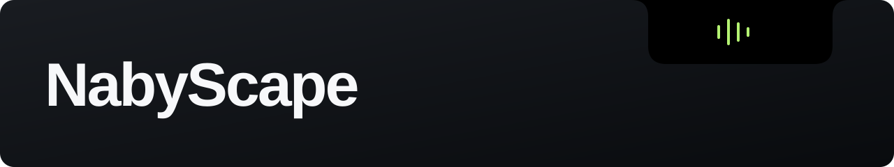
</p>

<h1 align="center">Your desktop, within reach.</h1>

<p align="center">Music, focus, and everyday tools at the top of your screen.<br>A customizable notch for Windows 11, built with C# and WPF.</p>

<p align="center">
  <a href="https://github.com/BillyNabil/nabyscape/actions/workflows/windows.yml"></a>
  
  
  <a href="LICENSE"></a>
</p>

<p align="center">
  <a href="https://github.com/BillyNabil/nabyscape/releases/latest"><strong>Download for Windows</strong></a>
  &nbsp; · &nbsp; <a href="#a-closer-look">Explore the app</a>
  &nbsp; · &nbsp; <a href="#build-from-source">Build from source</a>
</p>

## Small when you need space. Ready when you need more.

Keep an eye on your music without filling your desktop. Hover to browse previews, scroll to switch, and click when you want the full controls.

<table>
<tr>
<td width="50%" valign="top">
<h3>Stay compact</h3>
<p>Album artwork, a waveform, and the time in a small closed island.</p>
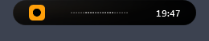
<h3>Hover to browse</h3>
<p>Playback, volume, and progress without opening a full panel.</p>
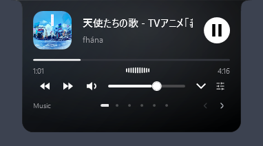
</td>
<td width="50%" valign="top">
<h3>Click for the full controls</h3>
<p>Choose a media session, seek through a track, or adjust the volume.</p>
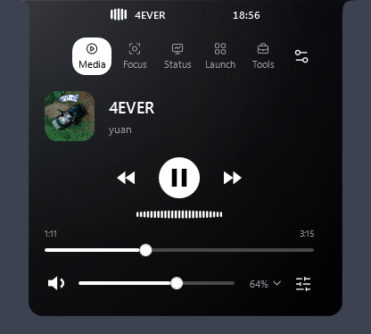
</td>
</tr>
</table>

**Hover → scroll or swipe → click.** Scrolling anywhere on a hover preview switches pages. It never opens a panel by itself.

## A closer look

<table>
<tr>
<td width="50%" valign="top">
<h3>Every app, its own volume</h3>
<p>Switch between Apps and Outputs. Individual sliders and mute controls keep each session separate.</p>
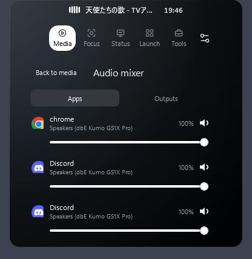
</td>
<td width="50%" valign="top">
<h3>Know what your PC is doing</h3>
<p>CPU history, memory, uptime, network, storage, processes, and hardware details in dedicated tabs.</p>
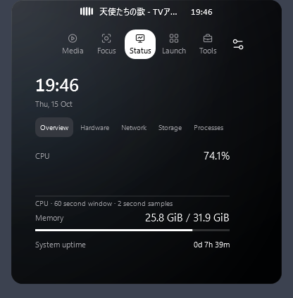
</td>
</tr>
<tr>
<td width="50%" valign="top">
<h3>A place for the small tasks</h3>
<p>File shelf, notes and tasks, opt-in clipboard history, local events, keep awake, and clean links.</p>
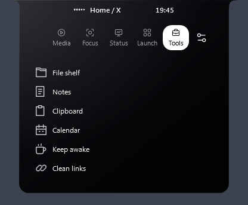
</td>
<td width="50%" valign="top">
<h3>Your calendar stays local</h3>
<p>Add events, browse the month, and keep upcoming plans inside the island.</p>
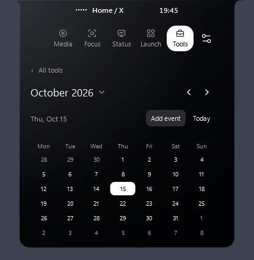
</td>
</tr>
</table>

<details>
<summary><strong>More screenshots: timers, hardware, and command search</strong></summary>

### Timers and focus

Start, pause, reset, or extend a countdown from its preview. Work and break durations are configurable.

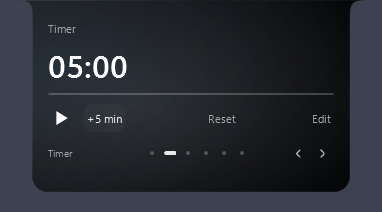

### Hardware at a glance

See CPU model/core information and available GPU measurements. Temperature and fan readings require a supported sensor provider; see the compatibility notes below.

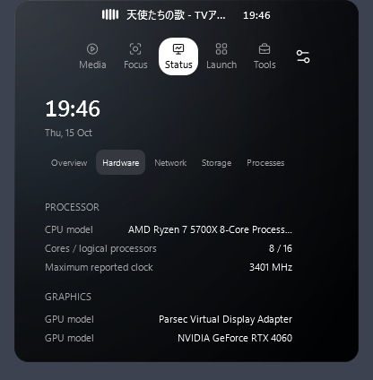

### Find an action

Open command search with **Ctrl+K** while NabyScape is focused. Search actions and saved shortcuts, then press Enter to run the first match.

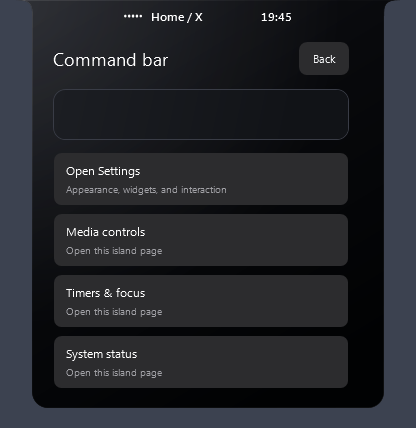

</details>

Screenshots show the interface with different media sessions and settings.

## New in 2.3: take the island further

- **Drag to Island.** Drag files onto the island or its tucked edge to stage them. Select several shelf items and drag them out together. Originals stay in place; cancelling a drag keeps your current editor intact.
- **Detachable previews.** Drag its grip to carry the window with your pointer, or use **Detach** to open it beside the preview. Music, Timer, Focus, Calendar, Notes, Shelf and System have borderless, resizable mini windows. Each uses the same live data. Always on top is optional; closing a preview leaves its activity running.
- **Activity actions.** Open **Launch → Activities** to combine opening apps, folders and websites with Focus and timed Keep awake. Customize the Study template, save, then Start. Stop ends only the Focus/Keep awake owned by that run.
- **Smart clipboard.** Text, links, images, and HEX/RGB colors get their own actions. Review cleaned links before copying, save images as PNG, or copy colors in either format. History remains opt-in.
- **Closed cover gestures.** With Artwork selected, click the cover to play/pause or hold for 500 ms to choose a media session. Clicking elsewhere opens the panel. Existing wheel preferences still apply.
- **Two live activities.** Choose a companion beside music: CPU usage, memory usage, the next local calendar event, Clock, or Timer/Focus. Automatic prefers a running countdown, then an event within 24 hours, then CPU (Clock if System is disabled). Hover to preview; click to open. Set the source in **Settings → Controls → Two live activities → Companion**. The companion withdraws while the island opens and returns when closed.

<table>
<tr>
<td width="50%" valign="top">
<h3>A timer you can keep nearby</h3>
<p>Detach without interrupting a countdown. Each preview opens only once and remembers its size and position.</p>
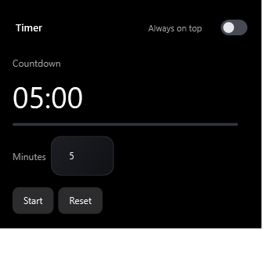
</td>
<td width="50%" valign="top">
<h3>Your notes, in every view</h3>
<p>The panel, hover preview and detached window edit one shared local document.</p>
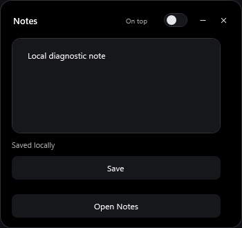
</td>
</tr>
<tr>
<td width="50%" valign="top">
<h3>Start a whole activity</h3>
<p>Choose the steps yourself. Activities run only when you press Start.</p>
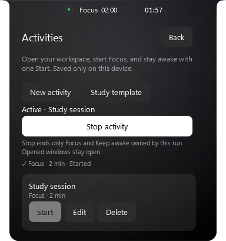
</td>
<td width="50%" valign="top">
<h3>A clipboard with useful actions</h3>
<p>Color detection offers HEX and RGB copying; links and images have their own controls.</p>
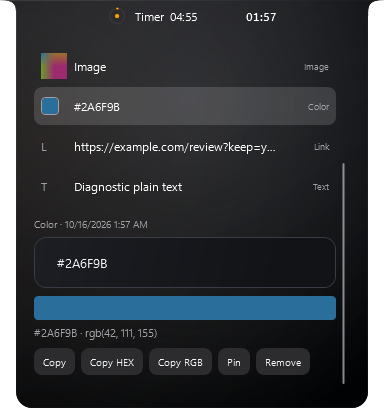
</td>
</tr>
</table>

Configure these features in **Settings → Controls**. Open panels support sideways swipes and horizontal trackpad scrolling; **Shift+wheel** switches panels anywhere outside text editors. Normal vertical scrolling stays available for long lists. **Appearance → Controls & outlines** changes button, input, outline and selected-tab colors. Typography has independent bold options for media and headings, with visual examples. System is an optional hover page, initially off. Manual hide also hides detached windows; automatic tucking only affects the island. Open windows return after manual show, but do not reopen automatically after restarting the app.

<details>
<summary><strong>Calendar and system mini windows</strong></summary>

<table><tr>
<td width="50%" valign="top">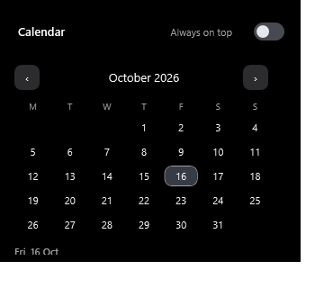</td>
<td width="50%" valign="top">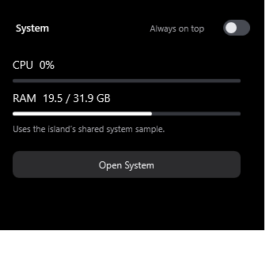</td>
</tr></table>

</details>

The 2.3 captures use local sample content. Windows window chrome can vary.

## Make it yours

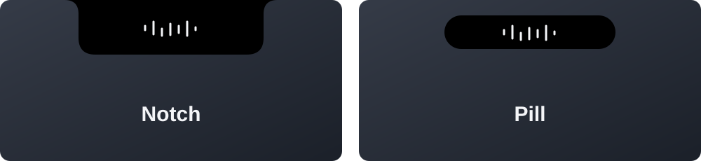

Choose a **notch** or a **pill**, then adjust color, opacity, material, size, placement, typography, content scale, and widget order. Settings includes descriptions and a live preview. Category and Launch controls can use icons, labels, or both.

Pick a monitor, choose which hover pages appear, or enable **Reduce Motion**. Fullscreen/maximized tucking leaves a small edge that you can hover to reveal. The tray menu can always recover a manually hidden island.

## Get NabyScape

1. Open the [latest release](https://github.com/BillyNabil/nabyscape/releases/latest). No GitHub account is needed to download.
2. Download **NabyScape-Setup.exe** and run it to install for your Windows user.
3. Prefer portable use? Download the **windows-x64-portable.zip**, extract it, and run **NabyScape.exe**.

Each release includes **SHA256SUMS.txt** for verifying the downloads. For development builds, use the [Windows build workflow](https://github.com/BillyNabil/nabyscape/actions/workflows/windows.yml); downloading its artifacts requires a GitHub account.

**Windows 11 x64 is required.** The self-contained build includes the .NET runtime; you do not need an SDK to run it. The current installer is unsigned. Portable use still stores preferences in your Windows user profile.

Open Settings from the island or tray. Changes save automatically. Starting with Windows is optional and off by default; closing Settings keeps the app running. Choose **Quit** from the tray to exit.

## Shortcuts that stay out of the way

| Shortcut | Action |
| --- | --- |
| `Ctrl+Alt+I` | Open or close the panel. |
| `Ctrl+Alt+H` | Hide or show the entire island. |
| `Ctrl+K` | Search commands while the panel is focused. |
| `Ctrl+Space` | Play/pause when the island header is focused and cover gestures are enabled. |
| `Ctrl+M` | Choose a media session from the focused island header when cover gestures are enabled. |
| `Escape` | Go back or close. |

The two global shortcuts are configurable. Buttons retain their click actions; wheel input on hover previews switches pages. After clicking open a panel, content scrolls normally.

## Compatibility and privacy

<details>
<summary><strong>Media sessions, audio routing, and waveforms</strong></summary>

Controls follow the Windows media sessions exposed by each app. Choose the app in **Media**. Waveforms read matching sessions across active outputs, so a selected Spotify session is not driven by Discord audio.

Hover and open Media views place a compact five-bar level indicator beside the artist name. The bars use different response timings with quick attack and smooth release; pause, mute, and Reduce Motion return them to a quiet baseline.

Choose **Appearance → Closed media icon** for album artwork or a waveform icon. **Closed media content** independently selects the song title or a compact waveform. Countdown and volume feedback keep priority.

Waveforms show amplitude history, not a frequency spectrum. They do not record audio or use the microphone. Optional gentle motion during quiet or unavailable readings is decorative. Unsupported app identities may use this fallback. Muted sessions return to a quiet baseline.

Mixer rows control individual Windows audio sessions; multiple sessions for one app can appear separately. Output selection changes the Windows default output. Apps with explicit routing preferences may keep their selected device.

</details>

<details>
<summary><strong>Hardware readings, glass, and motion</strong></summary>

- GPU measurements depend on Windows performance counters. Missing readings are labeled unavailable.
- Temperature/fan readings require an already running LibreHardwareMonitor or OpenHardwareMonitor WMI provider. NabyScape installs no sensor driver.
- Brightness feedback requires supported Windows events. There is no brightness slider or DDC/CI support.
- Battery controls hide on PCs without a battery.
- Focus mode manages sessions inside NabyScape; it does not change Windows Do Not Disturb.
- The glass surface uses WPF gradients, reflections, and artwork tint. It does not capture or blur the desktop.
- Animation follows the Windows compositor. Callback cadence does not guarantee GPU-present FPS. Reduce Motion disables continuous animation.

</details>

<details>
<summary><strong>Local data, clipboard privacy, and upgrading</strong></summary>

No account or cloud service is required. Preferences, timers, notes, tasks, shortcuts, and calendar events stay on this device. Clipboard history is opt-in; disabling it clears stored clipboard history and images. File shelf entries refer to the originals.

Existing installations retain these internal paths and identifiers for compatibility:

```text
%LOCALAPPDATA%\LumaIsland\             Local preferences and content
%LOCALAPPDATA%\Programs\LumaIsland\    Per-user installation
luma.layout.v1                         Existing layout-profile format
```

The executable, Start Menu shortcut, app display name, and enabled startup entry use **NabyScape**. Updates recognize previous app names and preserve settings, local content, and startup state. Internal single-instance and uninstall registration identifiers remain compatible.

Uninstall through **Windows Settings → Apps → Installed apps → NabyScape**. Personal content is retained. The current installer is unsigned.

</details>

## Build from source

You need **Windows 11 x64** and **.NET SDK 10**.

```powershell
git clone https://github.com/BillyNabil/nabyscape.git
cd nabyscape

# Publish the app and installer, then run logic checks.
.\build.ps1

# Also capture interactive desktop diagnostics.
# Quit running instances first and use a fresh output folder for each run.
.\build.ps1 -OutputDirectory '.\artifacts-desktop' -RunDiagnostics
```

Use `-Dotnet 'C:\path\to\dotnet.exe'` to select a specific SDK. Output defaults to `artifacts/`, including the app, installer, licenses, and `unit-report.txt`. The Windows workflow builds and tests pushes and pull requests; interactive desktop diagnostics run separately on a local Windows desktop.

<details>
<summary><strong>Verification and project structure</strong></summary>

Logic checks cover persistence, profile compatibility, audio fixtures, layout, tools, and services. Desktop diagnostics cover rendered bounds, hover navigation, Settings, media sessions, visibility, timers, and idle activity.

Desktop diagnostics use an isolated profile and a muted publisher. They do not change daily playback, routing, microphone state, or clipboard contents. A keep-awake test briefly prevents automatic sleep. Physical hot-plug, other DPI configurations, cross-app drops, hardware volume changes, clipboard-busy behavior, and battery transitions still need device-specific checks.

| Files | Responsibility |
| --- | --- |
| `OverlayWindow`, `CompactOverlay`, `PeekCarousel` | Overlay states, panels, and hover navigation. |
| `SettingsWindow`, `SettingsCustomization`, `CustomizationProfile` | Settings, previews, and layout profiles. |
| `Services`, `MediaAudioMeter`, `AudioDevices`, `AudioMixer`, `MixerOverlay` | Windows media and audio controls. |
| `SystemMonitor`, `HardwareMonitor`, `SystemMonitorOverlay` | System sampling and presentation. |
| `Productivity`, `UtilityServices`, `UtilityOverlay`, `RoadmapOverlay` | Local content and tools. |
| `Motion`, `LiveActivity`, `IslandGeometry`, `FramePerformance` | Motion, shape, activity, and pacing. |
| `App`, `Models`, `Native`, `Installer` | Lifecycle, storage, Windows integration, and installation. |
| `*Tests`, `Diagnostics`, `MediaFixture` | Logic and desktop verification. |

</details>

## Contribute

Found a bug or have a feature idea? [Open an issue](https://github.com/BillyNabil/nabyscape/issues) with your Windows version, app version, and steps to reproduce it. Screenshots are helpful; remove personal content before sharing them.

See [the roadmap](FEATURE-ROADMAP.md) for implemented capabilities and proposed additions. NotchNook and Vorssaint are feature references; their assets and implementations are not bundled.

## License

NabyScape is available under the [MIT License](LICENSE). Copyright (c) 2026 BillyNabil.

Dependency notices: [NAudio](NAudio-LICENSE.txt), [Lucide](LUCIDE-LICENSE.txt), [.NET](DOTNET-LICENSE.txt), and [.NET third-party components](DOTNET-ThirdPartyNotices.txt).
