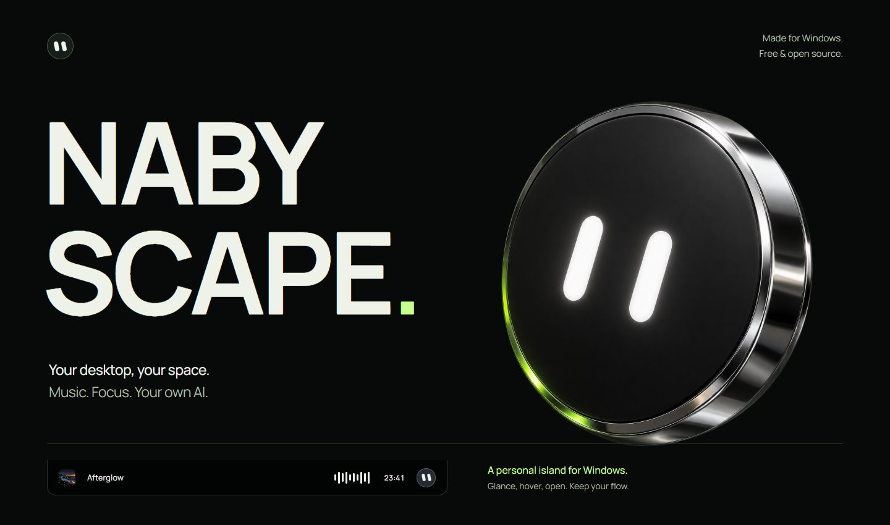
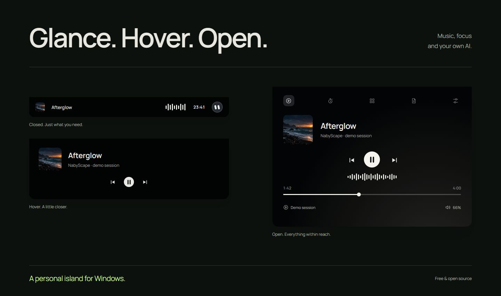
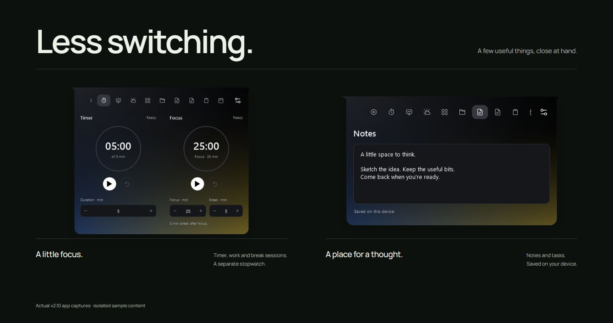
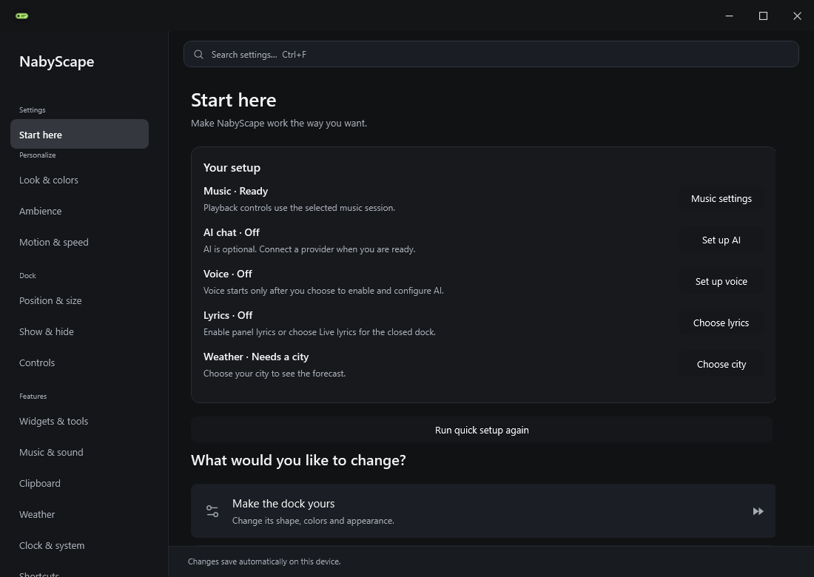

<p align="center"><a href="https://nabyscape.vercel.app/"></a></p>

<p align="center"><a href="https://github.com/BillyNabil/nabyscape/releases/latest"><strong>Download for Windows ↗</strong></a> &nbsp; · &nbsp; <a href="https://nabyscape.vercel.app/">Website</a> &nbsp; · &nbsp; <a href="docs/guide.md">User guide</a> &nbsp; · &nbsp; <a href="LICENSE">MIT licensed</a></p>

NabyScape brings music controls, everyday tools and an optional AI companion into one configurable island for Windows.

**Current release: [2.23.0](https://github.com/BillyNabil/nabyscape/releases/tag/v2.23.0).** Windows 10/11 packages are available for x64 and ARM64. Explore the [live website](https://nabyscape.vercel.app/), [release notes](docs/releases/v2.23.0.md) or [website source](website/).

## Your music, within reach

<p align="center"><a href="https://nabyscape.vercel.app/#experience"></a><br><sub>Illustrative dock states. Original artwork. <a href="https://nabyscape.vercel.app/#experience">Try the interactive demo ↗</a></sub></p>

Choose **Waveform**, **Live lyrics**, **Song title** or **None** for the closed dock. Long lyric lines become readable phrases with gentle crossfades. Hover keeps the familiar artwork, playback and volume controls. None leaves your music playing while the dock shows idle or your timer.

Playback, seeking, media-source selection, output switching and an app mixer use Windows media/audio support. Lyrics look up track title, artist and duration through LRCLIB. Spotify, YouTube Music and Apple Music sessions can use the same lookup when their player supplies usable metadata and timing. Coverage and sync vary; a compatible session is not a guarantee that a song has lyrics. Import a timed `.lrc` file when needed. No private music-service lyrics API is scraped.

Cover-inspired ambience supports a single color, a blend or your own palette. Tune direction, softness, spread and measured audio response. Idle, None and tucked states stay quiet and black. Reduce Motion is respected.

## Keep the useful things close

<p align="center"><br><sub>Actual v2.10 app captures · isolated sample content</sub></p>

Timer, work and break sessions, and a separate stopwatch retain their timing through restart and sleep. Weather shows a compact forecast for a city you choose; no location permission is requested.

Notes, Tasks, File shelf, Clipboard, Calendar, Keep awake and Clean links have their own places. Drag widgets into your order. Shelf keeps references to originals. Notes and tasks stay local; clipboard history starts only after you explicitly enable it.

Clock, battery and system panels are available where Windows and hardware support them. Drag the dock, type a pixel or percentage position, center it, or follow your cursor smoothly between monitors. Closed, hover and open dimensions remain independent.

## Meet Naby

Connect an API provider, a local compatible server or your own **Hermes Agent**. Naby handles chat, attachments and optional voice; Hermes manages its agent tools and permissions. API access is not bundled.

- **Chat:** formatted replies, image paste, image/video/PDF attachments and compatible image replies. Capabilities depend on the provider/model.
- **Voice:** realtime providers, automatic local speech packs, external ASR/TTS services or imported model files. Hardware suggestions help choose a pack; install it explicitly, then use it.
- **Hands-free:** optional local wake-word detection. End conversation resumes wake listening when enabled; explicit Stop pauses it.
- **Context:** choose a window or display to share. Screen and microphone access are explicit choices.
- **Connections:** save a provider, load or paste a model ID, and check the connection. API keys stay in Windows Credential Manager.

[AI setup](docs/assistant.md) · [Hermes connection guide](docs/hermes.md) · [Local speech models](docs/local-voice.md)

## Make yourself at home

New-user setup offers **Music / Productivity / AI / Custom**, followed by dock position and widget choices. Skip it or reopen it from **Start here**. Choosing a preset never enables microphone listening, clipboard capture or model downloads.

Settings now has wider navigation, visible voice-source choices and separate Voice setup, Wake word, Models and Check audio tabs. **Start here** distinguishes Ready, Needs setup, Saved/unchecked and unavailable features, with a next-step button. **Undo** restores the last saved appearance, layout or widget batch within the Settings window; it does not roll back content, credentials or background permissions.

<p align="center"></p>

**Widgets & tools → Feature usage** offers Essentials or Custom and explicit music-integration/download-watcher switches. Hidden pages reduce work, shared audio resources are released when unused, and weather requests cancel after their last consumer leaves. Animation quality follows your existing motion settings. Resource use still depends on active features, hardware and local AI models; there is no fixed RAM guarantee.

## Install & update

[**Open the latest published release →**](https://github.com/BillyNabil/nabyscape/releases/latest)

| Your PC | Installer for Windows 10 / 11 | Portable |
| --- | --- | --- |
| Intel or AMD 64-bit | [Download x64 Setup](https://github.com/BillyNabil/nabyscape/releases/download/v2.23.0/NabyScape-win-x64-Setup.exe) | [x64 ZIP](https://github.com/BillyNabil/nabyscape/releases/download/v2.23.0/NabyScape-win-x64-Portable.zip) |
| Windows on ARM | [Download ARM64 Setup](https://github.com/BillyNabil/nabyscape/releases/download/v2.23.0/NabyScape-win-arm64-Setup.exe) | [ARM64 ZIP](https://github.com/BillyNabil/nabyscape/releases/download/v2.23.0/NabyScape-win-arm64-Portable.zip) |

The same architecture-specific package targets Windows 10 build 19041 or later and Windows 11; no separate Windows 10 installer is needed. Windows 10 22H2 is recommended over older Windows 10 builds. OS/.NET support follows Microsoft's lifecycle. Windows 11 x64 is locally exercised; physical Windows 10 and native ARM64 execution have not been validated. Native local speech compatibility is separate: managed speech packs require an x64 process with AVX2/FMA; ARM64 can use compatible external speech servers or providers.

New in 2.23: a complete recommended preference snapshot and an easy uninstaller that can remove downloaded ASR/TTS models and local data. Dot navigation, microphone selection/testing and the installer folder chooser are included. New installations default to `%LOCALAPPDATA%\Programs\NabyScape`. Existing preferences are kept.

The .NET runtime is bundled. Installers are unsigned and install for the current Windows user. [SHA-256 checksums](https://github.com/BillyNabil/nabyscape/releases/download/v2.23.0/SHA256SUMS) · [Dependency notices](https://github.com/BillyNabil/nabyscape/releases/download/v2.23.0/NabyScape-Notices.zip).

New installs use the Daily Notch appearance. Upgrades preserve preferences and content. The recommended setup follows the selected daily preferences, including live lyrics, clipboard history, download alerts, startup and Naby. Automatic update checks are on; update downloads follow the snapshot and are off by default. Installation/restart remains explicit. Each feature has its own control. Quit from the tray to exit.

## Your desktop, your data

Notes, tasks, settings and shelf references stay in your Windows profile. Turning clipboard history off clears its stored history. Optional AI, lyrics, weather and update checks contact their configured services. Local speech uses additional RAM/VRAM beyond the dock itself.

[Privacy & compatibility](docs/guide.md#compatibility-and-privacy) · [Production foundations and limits](docs/production-foundations.md)

## See it in motion

[Watch the 29-second app tour →](https://github.com/BillyNabil/nabyscape/releases/download/v2.10.0/NabyScape-demo.mp4) · Silent · v2.10 recording

The film and Focus/Notes captures document the actual **v2.10** app. The dock-state scene is a web illustration; the Settings image is a fresh **2.21.1** capture. The chrome Naby is original brand artwork. [Capture provenance](docs/showcase.md) · [Current verification](docs/verification-refresh.md) · [Visual sources](docs/readme-web3-refresh.md).

## Build & verify

Use the .NET 10 SDK with Windows desktop support:

```powershell
# Compile, run logic tests, and validate Settings scene coverage
./build.ps1 -OutputDirectory artifacts

# Isolated UI diagnostics; keep personal profiles untouched
./artifacts/NabyScape.exe --diagnostics ./outputs/ui --isolated-diagnostics

# Static website integrity
node tools/check-website.mjs
```

[Build workflow](.github/workflows/windows.yml) · [Source](https://github.com/BillyNabil/nabyscape) · [Report an issue](https://github.com/BillyNabil/nabyscape/issues) · [Third-party notices](licenses/)


Uninstall from **Settings → General → Uninstall NabyScape**, the **Uninstall NabyScape** Start menu shortcut, or Windows Installed apps. Full cleanup is selected by default and removes application-managed models, caches, settings, history and saved API keys. Uncheck it to keep data for reinstalling. Imported files outside NabyScape and shared Windows components stay untouched.
