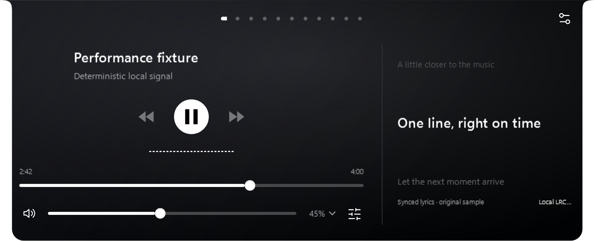
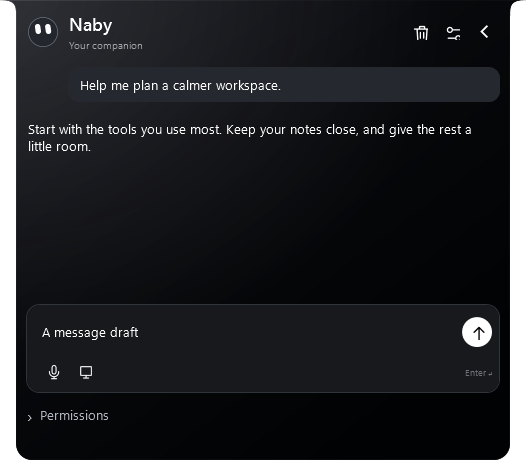
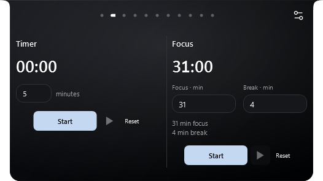
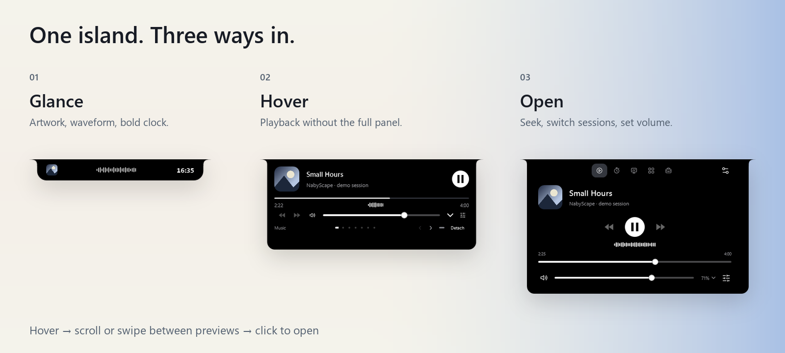
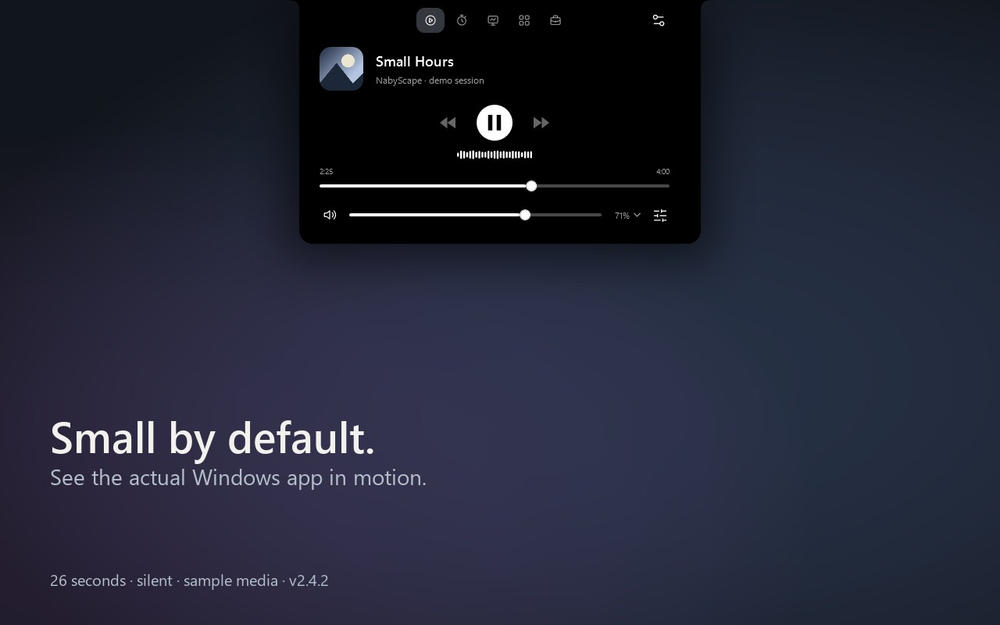
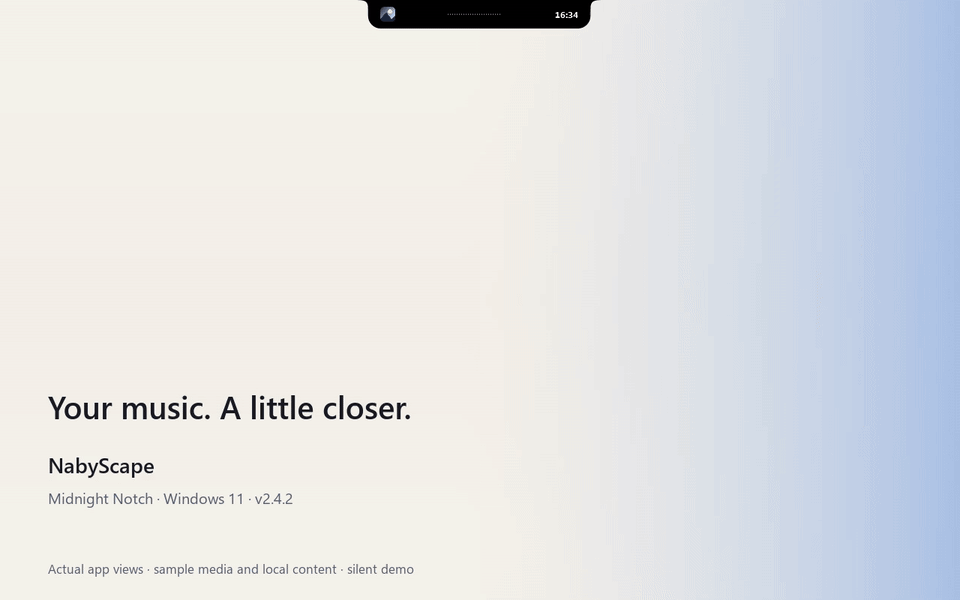
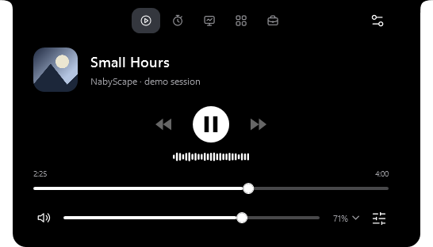
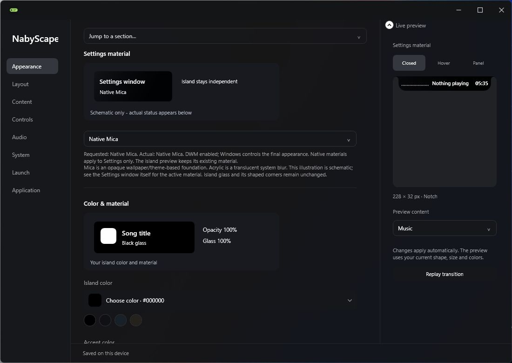
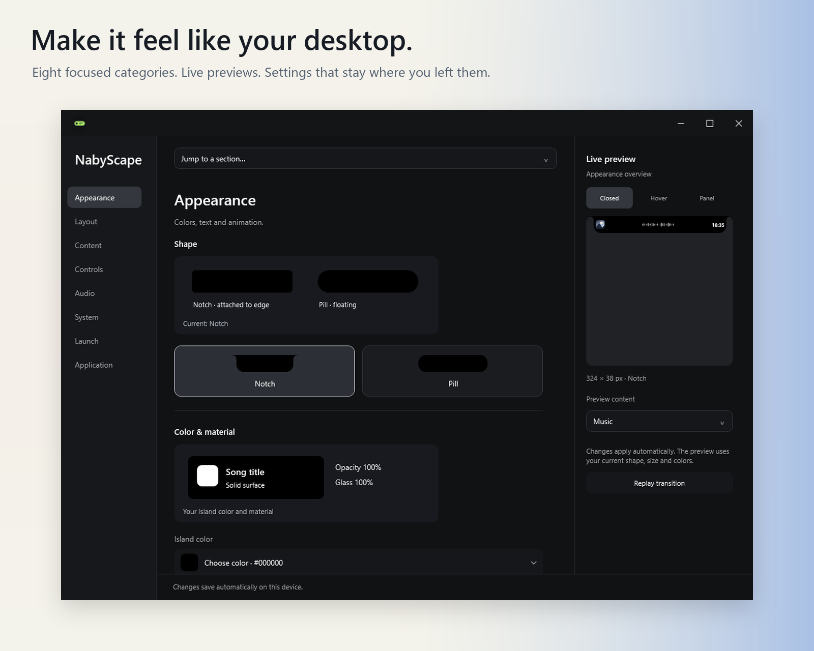

<p align="center">
  
</p>

<h1 align="center">NabyScape</h1>
<p align="center">Your music. A little company. Everything within reach.<br>A customizable island for Windows 11, small by default.</p>

<p align="center">
  <a href="https://nabyscape.sigma-bw-0740.chatgpt.site"><strong>Website</strong></a> ·
  <a href="https://github.com/BillyNabil/nabyscape/releases/latest"><strong>Download</strong></a> ·
  <a href="docs/guide.md">Guide</a> ·
  <a href="https://nabyscape.sigma-bw-0740.chatgpt.site/#experience">Interactive preview</a> ·
  <a href="https://github.com/BillyNabil/nabyscape/releases/download/v2.4.2/NabyScape-demo.mp4">Actual app demo</a>
</p>

<p align="center">
  <a href="https://github.com/BillyNabil/nabyscape/releases/latest"></a>
  <a href="https://github.com/BillyNabil/nabyscape/actions/workflows/windows.yml"></a>
  
  <a href="LICENSE"></a>
</p>

**Latest release: v2.7.2.** Synced Spotify lyrics beside your player, a more responsive measured spectrum, simpler Naby chat, individual tool panels and clipboard scrolling that keeps navigation in place. [Download the installer](https://github.com/BillyNabil/nabyscape/releases/download/v2.7.2/NabyScape-win-x64-Setup.exe) · [What's changed](docs/releases/v2.7.2.md)

The preview above is the actual v2.7.2 WPF interface with original sample content. The optional AI companion uses your own provider; API keys are stored in Windows Credential Manager and are never bundled.

## Music, with room for the words

Open lyrics from the icon beside playback. The island makes room for a dedicated right column; hide it to return to your saved width. On a narrow screen, the player and lyrics stack. Choose **Slide**, **Focus** or **Karaoke** in **Settings → Audio → Lyrics**, with a timing adjustment and a live sample.

<p align="center"></p>

Automatic lookup is opt-in and sends the Spotify track title, artist and duration to LRCLIB. Availability depends on the track and service; Retry and local `.lrc` import are available. Karaoke follows line timing. [Lyrics setup and limits](docs/guide.md#music-and-lyrics)

Even closed, the island follows the music. Its shared output spectrum measures 25 frequency bands, with a larger compact display and quick attack/release. Choose amplitude history or adjust sensitivity in **Settings → Audio → Visualizer**.

<p align="center"></p>

The animation uses a synthetic test signal. During normal use, frequency bands come from the media's output; other apps sharing that output can affect the spectrum. Selected-app amplitude history remains available.

## Less in the way

<table>
  <tr><th align="left">A quieter place to ask</th><th align="left">Your next session, your duration</th></tr>
  <tr><td width="58%"></td><td></td></tr>
</table>

- **Naby chat:** a simpler composer with voice and screen-sharing controls. Configure providers in the app's Settings; microphone, screen sharing and reviewed actions remain explicit choices.
- **Your tools, in your order:** Shelf, Notes, Tasks, Clipboard, Calendar, Keep awake and Clean links each have their own panel. Use icons, labels or minimal dots.
- **Scroll with intent:** wheel over navigation to change panels; scroll inside Clipboard to move only its history. Headers stay put, and the list remembers its position. Shift+wheel or a horizontal gesture can leave a list.
- **Move and resize:** enable **Settings → Layout → Move & resize**, then use the top grip and lower corners. Closed, hover and open-panel sizes remain independent; Escape cancels a drag.
- **Focus that fits:** edit Focus and Break minutes in the panel. Choose Chime, Bell, your own WAV or Off for completion feedback, with separate volume.
- **Optional browser previews:** switch off automatic browser-media previews in **Settings → Controls** if YouTube's hover playback interrupts your flow.

These are real WPF previews with sample content. [Media and interaction verification](docs/verification-media-ux-2.7.0.md) · [Clipboard and side-lyrics checks](docs/verification-scroll-lyrics-2.7.2.md)

## Glance. Hover. Open.

A quick look at your music and the time. A preview when you hover. Full controls when you click. Close it, and the island returns to its small footprint.

<p align="center"></p>

- **Glance:** artwork or an icon, a title or measured waveform, and a bold clock.
- **Hover:** browse the pages you enabled. Scroll or swipe sideways to switch.
- **Open:** click for the full panel. Wheel over navigation to switch panels; scroll inside a list or editor to read its content. Swipe sideways or use Shift+wheel outside text editors to switch panels.

**[Try the three states in your browser →](https://nabyscape.sigma-bw-0740.chatgpt.site/#experience)** The browser preview uses real app captures with sample content. It does not connect to Windows or play audio.

## See the actual app

[](https://github.com/BillyNabil/nabyscape/releases/download/v2.4.2/NabyScape-demo.mp4)

**[Watch the MP4 →](https://github.com/BillyNabil/nabyscape/releases/download/v2.4.2/NabyScape-demo.mp4)** · 26 seconds · 1280 × 800 · silent · v2.4.2

Captured from actual WPF controls using **Midnight Notch**. Artwork, notes, tasks and filenames are original sample content; the waveform uses a synthetic amplitude signal. No song, private notes or clipboard history was recorded. System readings come from the capture machine. Backgrounds and captions are presentation artwork. This is documentation media, not a GPU-presented-frame benchmark.

<details>
<summary>View the inline animated tour</summary>

[](https://github.com/BillyNabil/nabyscape/releases/download/v2.4.2/NabyScape-demo.mp4)

</details>

[Full visual tour and capture provenance](docs/showcase.md) · [Repository MP4](Assets/showcase/nabyscape-demo.mp4)

## The everyday, in reach

**Music.** Playback, seeking, Windows media-session selection, output volume, an app mixer and optional synced Spotify lyrics. Use output frequency bands or selected-app amplitude history; output loopback also includes other apps on the same device. Actions depend on what each media app exposes to Windows.

<p align="center"></p>

**System.** CPU, RAM, GPU and uptime in Overview; Hardware, Network, Storage and Processes have their own tabs. Missing readings stay labeled unavailable. [See compatibility details](docs/guide.md#compatibility-and-privacy).

**Notes and tasks.** One local document shared by the island and its detached view. Separate Notes and Tasks pages keep writing and checklists one click away.

**File shelf.** Stage up to 40 file/folder references, select several and drag them out together. Originals stay in place.

**Everyday tools.** Timer, Focus sessions, a local calendar, opt-in clipboard history, quick launch targets, Activities and timed Keep awake. Review cleaned links before copying; no page is fetched automatically. Focus does not change Windows Do Not Disturb.

**Detachable previews.** Pull Music, Timer, Focus, Calendar, Notes, Shelf or System onto the desktop. Move, resize or keep the view on top. Closing it leaves playback or countdowns running.

[Explore the gallery on the website →](https://nabyscape.sigma-bw-0740.chatgpt.site/#feature-title) · [Usage guide](docs/guide.md)

## Make it feel like your desktop

**New installs now start with Daily Notch:** 327 × 36 closed island, 526 px panel, 447 × 207 hover, black glass, artwork + waveform, icon navigation and 420 ms motion. Six hover pages are enabled; detachable previews, satellite and Activities start off. Existing installations keep their saved preferences. [Import the same default layout](docs/presets/default-layout.json). Clipboard capture, startup and download watching remain opt-in; no personal content or app targets are included.

<p align="center"></p>

Actual v2.5 Settings capture. The original gallery and silent film retain their v2.4.2 labels; they illustrate the shared design, not every new feature.



Choose a notch or floating pill. Tune dimensions, spacing, surface colors, typography and motion. Enable the tools and hover pages you use. Eight categories keep Appearance, Layout, Content, Controls, Audio, System, Launch and Application organized. Changes save automatically; the preview follows what you are exploring.

**[Download Midnight Notch](https://github.com/BillyNabil/nabyscape/releases/download/v2.4.2/Midnight-Notch.json)**, then open **Settings → Layout → Layout profile → Import layout**. [View the preset](docs/presets/midnight-notch.json) · [Explore all eight Settings pages](docs/showcase.md#settings-gallery)

The preset uses a 324 × 38 closed notch, 500 × 202 hover preview, 546 px panel, black surface, white accent, artwork + waveform, bold headings and 420 ms transitions. It includes visual/interaction preferences and enabled tools, excluding personal content, clipboard capture/history, app targets, startup and saved positions. Importing never enables clipboard capture.

## Download & first steps

**Windows 11 x64.** The self-contained builds include .NET; no SDK is needed to run the app.

- **[Download the v2.7.2 installer](https://github.com/BillyNabil/nabyscape/releases/download/v2.7.2/NabyScape-win-x64-Setup.exe)** — install for your Windows user.
- **[Download the v2.7.2 portable ZIP](https://github.com/BillyNabil/nabyscape/releases/download/v2.7.2/NabyScape-win-x64-Portable.zip)** — extract the entire archive, then run `NabyScape.exe`.
- [SHA-256 checksums](https://github.com/BillyNabil/nabyscape/releases/download/v2.7.2/SHA256SUMS) · [Release notes](https://github.com/BillyNabil/nabyscape/releases/tag/v2.7.2) · [Latest public release](https://github.com/BillyNabil/nabyscape/releases/latest)

The installer is currently unsigned. Download from the official repository and review the version and checksums before running. Portable mode still stores data in your Windows user profile. Starting with Windows is optional and off by default. Closing Settings keeps NabyScape running; choose **Quit** from the tray to exit.

| Shortcut | Action |
| --- | --- |
| `Ctrl+Alt+I` | Open or close the island panel. |
| `Ctrl+Alt+H` | Hide or show the entire island. |
| `Ctrl+Alt+T` | Toggle manual tuck; hover the top edge to reveal. |
| `Ctrl+K` | Search commands while the island is focused. |
| `Escape` | Go back or close. |

Global shortcuts are configurable. With cover gestures enabled, click closed artwork to play/pause, or hold for 500 ms to choose a session. [Gestures and keyboard details →](https://nabyscape.sigma-bw-0740.chatgpt.site/docs/#shortcuts)

## Local by design

No NabyScape account or cloud sync is required. Notes, tasks, events, preferences and optional clipboard history stay in your Windows profile. Clipboard history starts off; turning it off clears its saved history and images. Lyrics lookup is an opt-in request to LRCLIB using track metadata. The AI companion is optional and uses a provider you configure. API keys are not bundled; Windows Credential Manager stores them for your Windows user. The app does not automatically fetch link previews.

**AI companion · v2.6.3:** a character in the top island, with hover greetings, inline chat, live voice, selected-display context and reviewed app/desktop actions using your own provider. AI starts off; microphone, screen and control are explicit session choices. When enabled, the selected context goes to your configured provider. [Setup, provider support and privacy →](docs/assistant.md) · [Initial provider verification →](docs/verification-assistant-2.6.0.md) · [Interactive character preview →](docs/verification-assistant-character-2.6.2.md) · [Settings and chat layout →](docs/verification-ai-settings-2.6.3.md). API keys are not bundled; they are stored in Windows Credential Manager on your PC.

**v2.5.0** stores local data in `%LOCALAPPDATA%\NabyScape`. Upgrades copy and validate legacy data from `%LOCALAPPDATA%\LumaIsland`, preserving the original folder. The per-user install path and `luma.layout.v1` layout format remain compatible. [Privacy, migration and reset preservation rules →](https://nabyscape.sigma-bw-0740.chatgpt.site/docs/#privacy)

Version 2.4.2 reduces background work by sharing audio sampling, updating the views that need it and stopping static surfaces from rendering. [Read the local measurements, methodology and limits](docs/performance-2.4.2.md); results from the capture machine are not a promise for every PC. GPU use was not measured.

## New in v2.5.0

Included in the installer and portable downloads above:

- **Hover and tuck:** enabled hover pages work independently of main-panel visibility. Tucking animates from its current position, respects Reduce Motion, and stops immediately when hidden.
- **Audio mixer:** local app icons with a compact initials fallback; clearer mute controls and corrected Music → mixer → Back navigation.
- **Settings material:** Solid, Simulated glass, Native Mica and Native Acrylic. Native options apply to Settings only, require Windows 11 build 22621 or later, and fall back to Solid with a visible reason when unsupported. The island keeps its existing shaped simulated glass.
- **Updates and notices:** checks for official stable releases with a separate explicit install/restart action; routing for NabyScape's own notices. This does not read other apps' notifications.
- **Download activity:** off by default; infers arrivals from stable readable files in one folder. It cannot guarantee a browser has finished.
- **Stopwatch and placement:** a shared persisted stopwatch; Primary, Selected or Follow cursor display placement.
- **Preference care:** backed-up category/all reset, legacy-data migration, a manual tuck latch and an adjustable tucked edge.

[Features and practical limits](https://nabyscape.sigma-bw-0740.chatgpt.site/docs/#source-preview) · [Actual composed Settings captures and verification](docs/verification-2.5.0.md) · [Release/signing workflow](docs/RELEASING.md)

## Build it yourself

On Windows 11 x64 with **.NET SDK 10**:

```powershell
git clone https://github.com/BillyNabil/nabyscape.git
cd nabyscape
.\build.ps1
```

The script publishes the app and installer, includes third-party notices and runs logic checks. Use `-RunDiagnostics` on an interactive Windows desktop for rendered checks. CI builds pushes and pull requests; [workflow artifacts](https://github.com/BillyNabil/nabyscape/actions/workflows/windows.yml) provide development builds.

[Developer guide and source map](docs/guide.md#build-from-source) · [Recreate showcase captures](docs/showcase.md#reproduce-the-captures) · [Roadmap](docs/roadmap.md) · [Release workflow](docs/RELEASING.md)

## Contribute

[Open an issue](https://github.com/BillyNabil/nabyscape/issues) with your app version, Windows version and reproduction steps. Remove personal content before sharing captures. Code and documentation contributions are welcome.

Available under the **[MIT License](LICENSE)**. Copyright © 2026 BillyNabil.

Notices: [NAudio](licenses/NAudio-LICENSE.txt) · [Lucide](licenses/LUCIDE-LICENSE.txt) · [.NET](licenses/DOTNET-LICENSE.txt) · [.NET third-party components](licenses/DOTNET-ThirdPartyNotices.txt).
