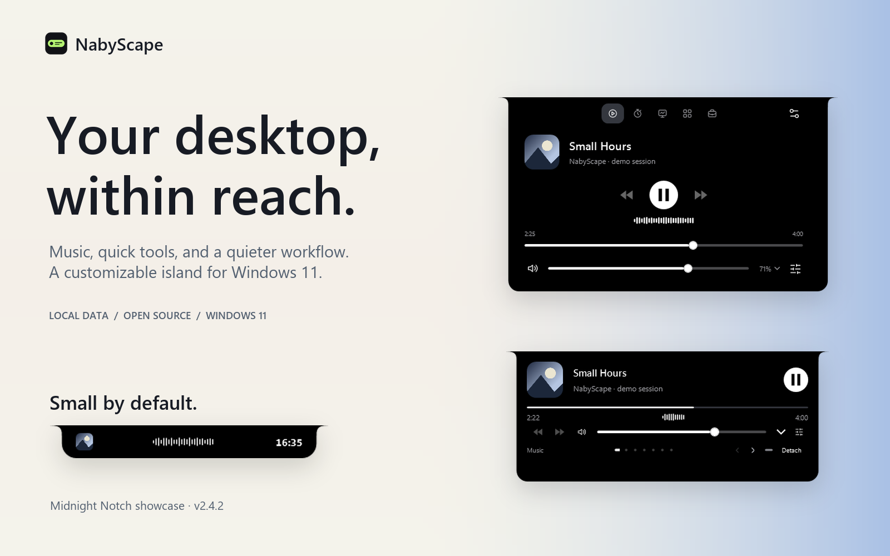
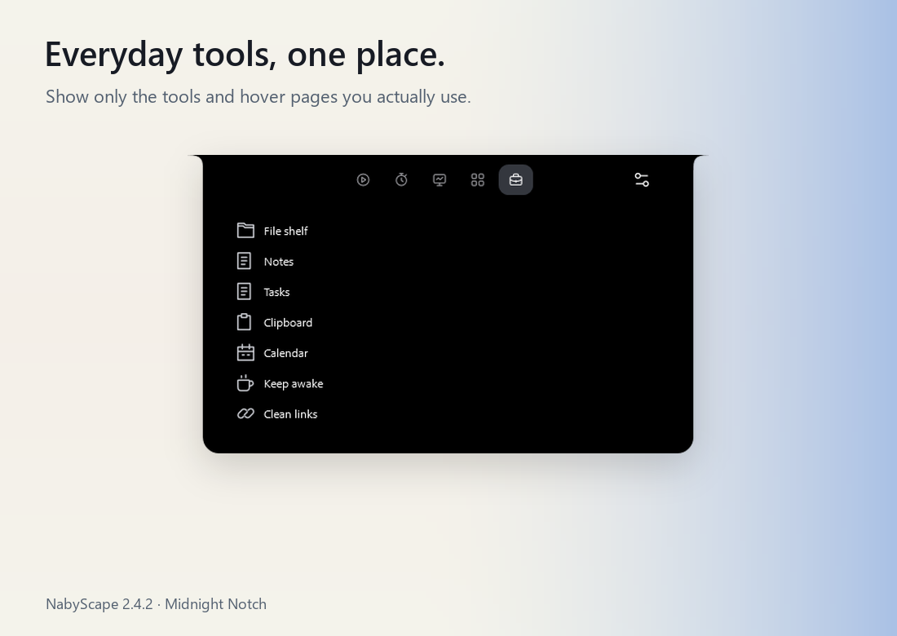
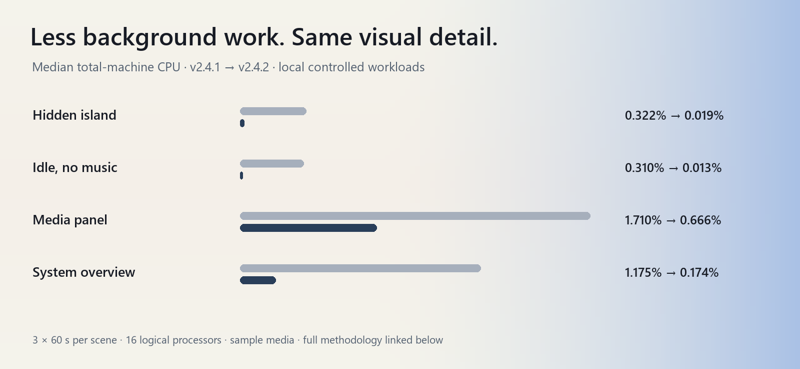

<p align="center">
  
</p>

<h1 align="center">NabyScape</h1>
<p align="center">A small, customizable island for Windows 11.<br>Music, system stats, and everyday tools—one hover away.</p>

<p align="center">
  <a href="https://github.com/BillyNabil/nabyscape/releases/latest"></a>
  <a href="https://github.com/BillyNabil/nabyscape/actions/workflows/windows.yml"></a>
  
  <a href="LICENSE"></a>
</p>

<p align="center">
  <a href="https://github.com/BillyNabil/nabyscape/releases/latest"><strong>Download</strong></a> ·
  <a href="#see-it-in-motion">Watch the demo</a> ·
  <a href="#make-it-yours">Explore Settings</a> ·
  <a href="docs/showcase.md">Full visual tour</a> ·
  <a href="#build-it-yourself">Build it yourself</a>
</p>

## See it in motion

<p align="center">
  <a href="https://github.com/BillyNabil/nabyscape/releases/download/v2.4.2/NabyScape-demo.mp4">
    
  </a>
</p>

**[Watch or download the 1280 × 800 MP4 →](https://github.com/BillyNabil/nabyscape/releases/download/v2.4.2/NabyScape-demo.mp4)** · 26 seconds · silent · 30 fps capture.

These are captures of the actual WPF interface using the author's current visual preferences, available as **Midnight Notch** below. The demo uses original sample artwork, sample text and a synthetic amplitude signal; it contains no recorded song, personal notes or clipboard history. The production waveform follows the selected app's audio. Backgrounds and captions are presentation artwork, outside the app.

## Glance. Hover. Open.


- **Glance:** artwork or an icon, a title or a waveform, and a bold clock.
- **Hover:** browse the previews you enabled. Scroll or swipe sideways to switch.
- **Open:** click for the full panel. Scroll long content normally; swipe sideways or use Shift+wheel to switch panels outside text editors.

The open media panel leaves out the compact header, so the same track is not shown twice. Closing a panel returns the island to its small footprint.

## What lives inside

<table>
<tr>
<td width="50%" valign="top">
<h3>Music, without the detour</h3>
<p>Artwork, play/pause, seeking, session selection, output volume and an app mixer. The waveform follows the selected media app across active outputs.</p>

</td>
<td width="50%" valign="top">
<h3>A quick look at your PC</h3>
<p>CPU, RAM, GPU and uptime in Overview. Hardware, Network, Storage and Processes have their own tabs. Long content scrolls without a scrollbar covering it.</p>

</td>
</tr>
<tr>
<td width="50%" valign="top">
<h3>Notes that stay close</h3>
<p>Capture a thought in one local document. The panel and detached Notes view share it. A Tasks tab keeps small to-dos beside your notes.</p>

</td>
<td width="50%" valign="top">
<h3>Files, ready to hand over</h3>
<p>Drop files or folders onto the island. Select several and drag them out together. The shelf stores references; originals stay in place. Up to 40 items.</p>

</td>
</tr>
<tr>
<td width="50%" valign="top">
<h3>A calendar that stays local</h3>
<p>Add events yourself and browse the month. There is no calendar account to connect. Enable its hover preview when you want upcoming plans nearby.</p>

</td>
<td width="50%" valign="top">
<h3>Keep a preview on your desktop</h3>
<p>Drag the grip to detach Music, Timer, Focus, Calendar, Notes, Shelf or System. Resize it, move it, or choose Always on top. Closing a view leaves the activity running.</p>

</td>
</tr>
</table>

<details>
<summary><strong>More tools: clipboard, focus, shortcuts and activities</strong></summary>

| Tool | What you can do |
| --- | --- |
| **Smart clipboard** | Opt in to local history. Text, links, images and valid HEX/RGB colors get relevant actions. Review a cleaned link before copying; save an image or copy a color. Pause or turn off history at any time. |
| **Timer & Focus** | Start, pause, reset and extend countdowns. Set work/break durations. Views share the same session. |
| **Launch** | Save apps, folders and websites. Search commands with Ctrl+K while the island is focused. |
| **Activities** | Save an ordered routine of launch targets, Focus and timed Keep awake. Start it yourself. Stop ends the Focus/Keep awake still owned by that activity. |
| **Keep awake** | Temporarily prevent sleep, optionally keeping the display awake. |
| **Clean links** | Preview the result of removing recognized tracking parameters before copying it. No page is fetched or opened automatically. |
| **Companion activity** | Optionally show CPU, memory, an event, Clock or a Timer/Focus countdown beside music. It withdraws while the island opens. |



</details>

## Make it yours


Choose a **notch** or a **floating pill**. Tune the dimensions, spacing, colors, opacity, glass, typography and motion. Keep the tools you use; turn the others off. The right preview follows the setting you are exploring, while changes preserve your place in the form.

| Settings category | What belongs there |
| --- | --- |
| **Appearance** | Shape, surface colors, controls and outlines, bold titles, navigation labels, motion and frame policy. |
| **Layout** | Monitor, position, closed/hover/panel dimensions, spacing, layout import and export. |
| **Content** | Panel order, individual tools, hover pages and clipboard history. |
| **Controls** | Hover timing, swipes, cover gestures, detach, drag reveal, shortcuts and automatic tucking. |
| **Audio** | Closed media display, waveform behavior, volume/brightness feedback and mixer access. |
| **System** | Clock format and available monitoring details. |
| **Launch** | App/folder/web shortcuts and Activities. |
| **Application** | Start with Windows, local storage and app information. |

**[Explore all eight Settings pages at full size →](docs/showcase.md#settings-gallery)**

### Use the layout in this showcase

**[Download Midnight Notch](https://github.com/BillyNabil/nabyscape/releases/download/v2.4.2/Midnight-Notch.json)** · [View the preset](docs/presets/midnight-notch.json)

1. Download the JSON file.
2. Open **Settings → Layout → Layout profile → Import layout**.
3. Choose the file. Changes apply automatically; adjust anything from there.

The preset uses a 324 × 38 closed notch, 500 × 202 hover preview, a 546 px panel width, black surface, white accent, artwork + waveform, bold headings, and 420 ms transitions. The companion is off, matching the author's layout. It contains visual and interaction preferences, including enabled tools and their order. It excludes notes, clipboard data, app targets, startup preferences and saved window positions. Importing it does not enable clipboard capture.

## Less background work



Version **2.4.2** shares audio sampling, updates only the views that need it, and lets static surfaces stop rendering. The waveform, bar count, spring motion, effects, animation duration and frame-rate policy remain intact.

These are local results from a 16-logical-processor machine, with three 60-second runs per scene and deterministic sample media. They are not a promise for every PC. GPU use was not measured; WPF callback timing is distinct from GPU-presented frames. Read the **[measurements, raw data and limitations](docs/performance-2.4.2.md)**.

## Get started

**Windows 11 x64.** Self-contained builds include .NET; you do not need an SDK to run the app.

1. Open the **[latest release](https://github.com/BillyNabil/nabyscape/releases/latest)**.
2. Run **NabyScape-Setup.exe**, or extract **NabyScape-windows-x64-portable.zip** and run **NabyScape.exe**.
3. Hover over the island, then click to open. Open Settings from the island or its tray menu.

The installer is currently unsigned. Startup is optional. Closing Settings keeps NabyScape running; choose **Quit** in the tray to exit. Release downloads include SHA-256 checksums. Portable mode still stores preferences in your Windows user profile.

| Shortcut | Action |
| --- | --- |
| `Ctrl+Alt+I` | Open or close the island panel. |
| `Ctrl+Alt+H` | Hide or show the island. |
| `Ctrl+K` | Command search while the island is focused. |
| `Escape` | Go back or close. |

Global shortcuts are configurable. With artwork gestures enabled, click the closed cover to play/pause or hold for 500 ms to choose a session. Hover the tucked edge to reveal an automatically hidden island.

## Local by design

No NabyScape account, cloud sync or AI service. Notes, tasks, clipboard history, events and preferences stay in your Windows profile. Clipboard history is opt-in, and turning it off clears the history. The app does not fetch link previews automatically or record audio through the microphone.

<details>
<summary><strong>Compatibility and practical details</strong></summary>

- Media controls depend on Windows media sessions exposed by the selected app. Some apps cannot seek or skip.
- Waveforms display **amplitude history**, not a frequency spectrum. Optional quiet fallback motion is decorative; muted sessions settle to a quiet baseline.
- GPU readings depend on Windows performance counters. Temperature/fan data needs an already running supported LibreHardwareMonitor/OpenHardwareMonitor WMI provider. NabyScape installs no sensor driver.
- Glass uses gradients, reflections and artwork tint; it does not capture or blur the desktop.
- Brightness feedback requires supported Windows events. Battery controls appear only on devices with a battery.
- Focus sessions do not change Windows Do Not Disturb. No activity runs automatically after restart.
- The compatible `%LOCALAPPDATA%\LumaIsland` storage path and `luma.layout.v1` profile format remain in use. Updates preserve personal data and startup preference.

See the **[full usage, privacy and compatibility guide](docs/guide.md)**.

</details>

## Build it yourself

On Windows 11 x64 with **.NET SDK 10**:

```powershell
git clone https://github.com/BillyNabil/nabyscape.git
cd nabyscape
.\build.ps1
```

The build publishes the app and installer, includes third-party notices, and runs logic checks. Use `-RunDiagnostics` on an interactive Windows desktop for rendered UI checks. CI builds pushes and pull requests; **[workflow artifacts](https://github.com/BillyNabil/nabyscape/actions/workflows/windows.yml)** provide development builds.

**[Developer and verification guide](docs/guide.md#build-from-source)** · **[Recreate the showcase](docs/showcase.md#reproduce-the-captures)** · **[Roadmap](docs/roadmap.md)**

<details>
<summary><strong>Repository layout</strong></summary>

```text
nabyscape/
├── src/NabyScape/       Application, features, UI, motion, tests and diagnostics
├── Assets/             README visuals, screenshots and demo media
├── docs/               Guides, presets, releases, roadmap and performance evidence
├── licenses/           Third-party license notices
├── tools/              Documentation tooling
├── NabyScape.slnx      Solution for Visual Studio and dotnet build
├── build.ps1           Standalone publish, installer packaging and logic checks
├── LICENSE
└── README.md
```

See the [source map](docs/guide.md#source-layout) for the application folders. Tests and diagnostics share the application assembly so they exercise the shipped implementation through the existing `--self-test` and `--diagnostics` entry points.

</details>

## Contribute

Found a problem or have an idea? **[Open an issue](https://github.com/BillyNabil/nabyscape/issues)** with your app version, Windows version and reproduction steps. Remove personal content before sharing captures. Code and documentation contributions are welcome.

Available under the **[MIT License](LICENSE)**. Copyright © 2026 BillyNabil.

Notices: [NAudio](licenses/NAudio-LICENSE.txt) · [Lucide](licenses/LUCIDE-LICENSE.txt) · [.NET](licenses/DOTNET-LICENSE.txt) · [.NET third-party components](licenses/DOTNET-ThirdPartyNotices.txt).
