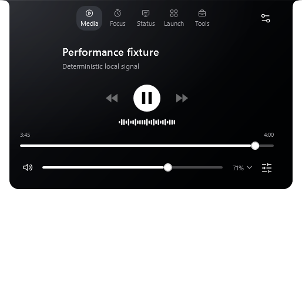
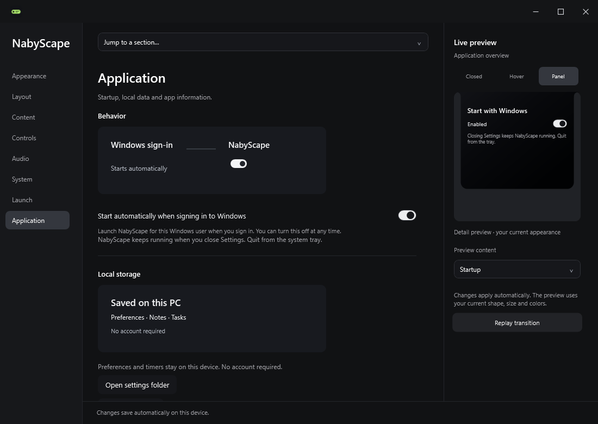
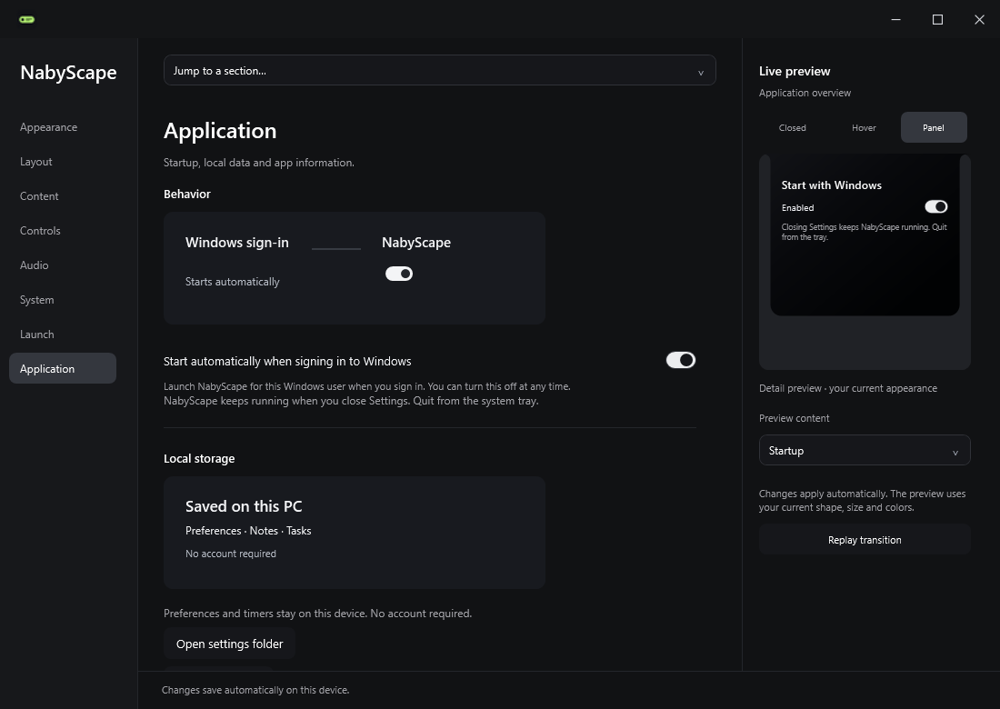
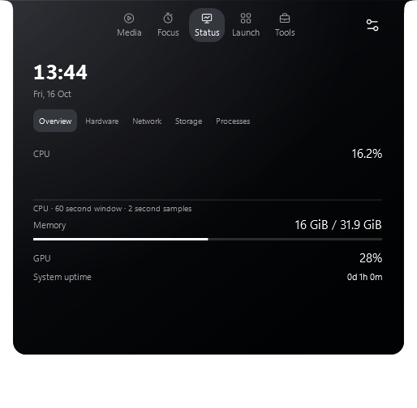
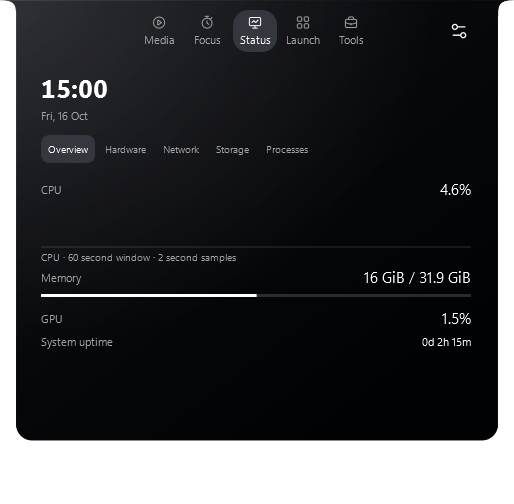

# NabyScape 2.4.2 performance verification

Local Windows Release builds; 16 logical processors, WPF render tier 2. No dependency or framework change. The waveform algorithm, number of bars, animation durations, spring/easing, and existing frame-rate policy are retained.

Each of fourteen scenes has three 60-second measurements after a three-second scene warm-up. Tables show the median of the three runs. CPU is percent of the entire machine, not a single logical processor. Media uses deterministic metadata and amplitude without playback or native audio writes. System-monitor readings use the real machine. The slider workload changes the value every 100 ms with the existing 180 ms save debounce; it measures continuous preview work rather than repeatedly committed edits. Separate editor-retention checks cover the apply path.

Both final runs use the same monitor, DPI and reported refresh rate, recorded at the start/end of every scene. Earlier interrupted or mixed-refresh measurements were excluded. Other desktop activity was not independently controlled; absolute memory is sensitive to process lifetime and native caches. This is a local comparison, not a laboratory GPU presentation benchmark. Changes were measured as one combined candidate; savings are not attributed independently to each subsystem.

Baseline source: `bedaf2d` (v2.4.1 with diagnostic instrumentation only). Candidate: v2.4.2. The main tables are the complete matched workload before the final adaptive-CPU demand guard. That guard restores CPU-pressure input for Auto only while animations need it, without changing the FPS formula. Its five affected animation scenes plus hidden/paused idle were remeasured on the release build; those results are reported separately below. GPU utilization was unavailable; WPF callback intervals below are **island render callbacks**, not GPU-presented frames or Settings frame intervals.

## CPU and allocation

| Scene | CPU % before / after | CPU reduction | Allocation KiB/s before / after |
| --- | ---: | ---: | ---: |
| hidden | 0.322 / 0.019 | 94.0% | 16.82 / 1.58 |
| closed-paused | 0.310 / 0.013 | 95.8% | 19.02 / 3.19 |
| closed-playing | 0.701 / 0.405 | 42.2% | 828.49 / 850.72 |
| hover-music | 1.186 / 0.628 | 47.1% | 1955.67 / 1854.29 |
| panel-media | 1.710 / 0.666 | 61.0% | 2656.24 / 2333.86 |
| settings-static | 0.333 / 0.016 | 95.2% | 38.57 / 3.25 |
| settings-moving | 0.874 / 0.524 | 40.1% | 1513.89 / 1196.56 |
| settings-slider | 1.274 / 0.805 | 36.8% | 4361.20 / 3613.50 |
| system-overview | 1.175 / 0.174 | 85.2% | 3550.86 / 1350.89 |
| system-hardware | 1.217 / 0.168 | 86.2% | 3676.87 / 1356.64 |
| system-network | 1.301 / 0.050 | 96.2% | 4244.76 / 171.20 |
| system-storage | 1.350 / 0.032 | 97.6% | 3544.74 / 43.14 |
| system-processes | 1.200 / 0.055 | 95.4% | 3644.64 / 664.59 |
| mini-windows | 0.746 / 0.361 | 51.6% | 856.47 / 871.87 |

## Memory and handles

Every cell is **before / after**.

| Scene | Private MiB | Working set MiB | Handles | Handle growth |
| --- | ---: | ---: | ---: | ---: |
| hidden | 233.8 / 208.9 | 380.2 / 366.3 | 1031 / 939 | 21 / -14 |
| closed-paused | 233.9 / 209.4 | 380.2 / 366.8 | 1005 / 936 | 25 / -2 |
| closed-playing | 234.7 / 208.9 | 380.0 / 366.4 | 993 / 929 | -61 / -4 |
| hover-music | 271.1 / 235.3 | 381.2 / 369.7 | 993 / 929 | -2 / -3 |
| panel-media | 281.2 / 253.5 | 381.1 / 373.5 | 1001 / 935 | 0 / 3 |
| settings-static | 304.1 / 214.9 | 381.4 / 368.5 | 994 / 906 | 20 / -9 |
| settings-moving | 264.3 / 222.4 | 380.9 / 370.4 | 965 / 908 | -9 / -12 |
| settings-slider | 273.1 / 224.4 | 387.0 / 375.4 | 962 / 902 | -10 / -11 |
| system-overview | 301.3 / 270.3 | 393.0 / 383.5 | 1003 / 925 | 2 / -7 |
| system-hardware | 307.8 / 275.3 | 391.2 / 380.5 | 1003 / 935 | -2 / -2 |
| system-network | 318.4 / 275.7 | 382.1 / 380.6 | 1007 / 947 | 3 / -3 |
| system-storage | 321.5 / 273.9 | 381.4 / 383.0 | 1011 / 944 | 5 / -3 |
| system-processes | 327.7 / 283.9 | 384.4 / 385.2 | 1012 / 946 | 1 / -5 |
| mini-windows | 263.7 / 218.9 | 381.4 / 377.9 | 1069 / 1003 | -14 / -9 |

## Callback pacing and audio reads

Every cell is **before / after**.

| Scene | p95 ms | p99 ms | Render callbacks / 60 s | Physical audio reads / 60 s |
| --- | ---: | ---: | ---: | ---: |
| hidden | — / — | — / — | 0 / 0 | 0 / 0 |
| closed-paused | — / — | — / — | 0 / 0 | 0 / 0 |
| closed-playing | 25.21 / 25.00 | 33.61 / 33.33 | 3385 / 3527 | 1348 / 1775 |
| hover-music | 8.33 / 8.33 | 15.83 / 8.33 | 6841 / 7195 | 1634 / 1799 |
| panel-media | 8.33 / 8.33 | 15.90 / 8.33 | 6816 / 7197 | 1623 / 1799 |
| settings-static | — / — | — / — | 0 / 0 | 0 / 0 |
| settings-moving | 25.00 / 25.00 | 33.61 / 25.00 | 3419 / 3561 | 3693 / 1787 |
| settings-slider | 25.00 / 25.00 | 33.61 / 33.33 | 3383 / 3529 | 2514 / 1783 |
| system-overview | 8.33 / — | 16.67 / — | 6778 / 0 | 1638 / 0 |
| system-hardware | 8.33 / — | 15.90 / — | 6832 / 0 | 1636 / 0 |
| system-network | 8.33 / — | 16.67 / — | 6705 / 0 | 1634 / 0 |
| system-storage | 8.33 / — | 16.67 / — | 6753 / 0 | 1636 / 0 |
| system-processes | 8.33 / — | 16.32 / — | 6780 / 0 | 1625 / 0 |
| mini-windows | 25.21 / 25.00 | 33.61 / 33.33 | 3421 / 3518 | 1367 / 1771 |

## Garbage collections per measurement

Every cell is **before / after**.

| Scene | Gen 0 | Gen 1 | Gen 2 | Private growth MiB |
| --- | ---: | ---: | ---: | ---: |
| hidden | 0 / 0 | 0 / 0 | 0 / 0 | -0.25 / -2.93 |
| closed-paused | 0 / 0 | 0 / 0 | 0 / 0 | 0.01 / 0.05 |
| closed-playing | 3 / 3 | 1 / 0 | 0 / 0 | -0.05 / -0.37 |
| hover-music | 7 / 7 | 0 / 2 | 0 / 0 | 7.14 / 1.47 |
| panel-media | 10 / 8 | 1 / 1 | 0 / 0 | -4.93 / 0.50 |
| settings-static | 0 / 0 | 0 / 0 | 0 / 0 | -10.95 / -47.51 |
| settings-moving | 5 / 4 | 1 / 1 | 0 / 0 | -55.47 / -3.98 |
| settings-slider | 17 / 14 | 2 / 2 | 1 / 0 | -1.78 / -8.04 |
| system-overview | 13 / 5 | 2 / 0 | 0 / 0 | 0.16 / -1.83 |
| system-hardware | 14 / 5 | 1 / 1 | 0 / 0 | 2.68 / -1.90 |
| system-network | 15 / 1 | 7 / 0 | 0 / 0 | 3.27 / -5.84 |
| system-storage | 13 / 0 | 5 / 0 | 0 / 0 | 1.39 / -0.05 |
| system-processes | 13 / 3 | 6 / 0 | 0 / 0 | 2.84 / 4.50 |
| mini-windows | 3 / 3 | 1 / 0 | 0 / 0 | -19.05 / -33.07 |

## Release follow-up: adaptive Auto policy

Three 60-second repeats per listed scene on the release artifact. These filtered runs have a different process/cache history, so their RAM/GC snapshots are retained as raw data and are not substituted into the full-workload memory comparison above.

| Scene | Baseline CPU % | Release CPU % | Audio reads / 60 s | Callback p95 / p99 ms |
| --- | ---: | ---: | ---: | ---: |
| hidden | 0.322 | 0.016 | 0 | — / — |
| closed-paused | 0.310 | 0.014 | 0 | — / — |
| closed-playing | 0.701 | 0.368 | 1747 | 25.00 / 33.33 |
| hover-music | 1.186 | 0.758 | 1798 | 8.33 / 8.33 |
| panel-media | 1.710 | 0.659 | 1798 | 8.33 / 8.33 |
| settings-moving | 0.874 | 0.532 | 1791 | 25.00 / 33.33 |
| settings-slider | 1.274 | 0.944 | 1755 | 25.00 / 33.33 |

The release follow-up also repeats 100 window cycles. Retained closed windows: 0; update/settings subscriber growth: 0/0; handle growth: 3.

## Lifecycle and functional checks

After five warm-up cycles, the retention diagnostic opens/closes the panel, Settings, and Notes mini window 100 times. Forced GC is used only in this isolated diagnostic, outside the timed scenes.

| Metric | Before | After |
| --- | ---: | ---: |
| handleGrowth | -7 | -5 |
| managedGrowthBytes | -229632 | -142072 |
| remainingSettings | 0 | 0 |
| remainingMiniWindows | 0 | 0 |
| retainedClosedWindows | Not instrumented | 0 |
| updateSubscriberGrowth | Not instrumented | 0 |
| settingsSubscriberGrowth | Not instrumented | 0 |

The candidate additionally tracks weak references to closed Settings/mini windows and changes in App update/settings subscriptions. A small one-off handle increase is not by itself proof of a leak; the preflight and warmed final cycle reports are retained separately.

- `performance-checks242-shipping`: 16 checks passed; zero failures.
- `desktop242-final`: 701 check passed; zero failures.
- `tools242`: 15 checks passed; zero failures.
- `audio242-release`: 1 check passed; zero failures.
- `premium242-final`: 212 checks passed; zero failures.

Logic checks: 286 passed. Desktop captures include minimum/default widths and 100%, 150%, and 200% bitmap rendering. These verify WPF layout/rasterization; physical monitor removal, moving between monitors with different DPI, and hardware device hot-plug still require hands-on device checks. Read-only native audio diagnostics do not automate Spotify playback or change output routing.

## App captures

Actual WPF captures with a deterministic local media fixture. Track position, clock, waveform amplitude, and live system readings naturally differ between captures.

| View | v2.4.1 | v2.4.2 |
| --- | --- | --- |
| Media panel |  |  |
| Static Settings |  |  |
| System overview |  |  |

## Reproduce

Build Release with `build.ps1`, quit running NabyScape instances, then run:

```powershell
.\artifacts\NabyScape.exe --diagnostics "$PWD\artifacts\performance" --performance-benchmark
```

The full run takes about 45 minutes. `--benchmark-runs`, `--benchmark-seconds`, and `--benchmark-scenarios` support focused reruns; label shortened runs separately.

Release follow-up: [timed runs](performance/2.4.2/release-followup.json), [retention](performance/2.4.2/retention-release.json).

Raw measurements: [baseline](performance/2.4.2/baseline.json), [candidate](performance/2.4.2/candidate.json), [baseline retention](performance/2.4.2/retention-baseline.json), [candidate retention](performance/2.4.2/retention-candidate.json).

## Warm startup observations

One warm-up per build, then three starts in alternating order with the existing local profile. Both builds use the same optional one-shot ContentRendered instrumentation. Neither milestone measures first GPU presentation, cold boot, or media-metadata readiness.

| Milestone | Baseline median ms | Candidate median ms |
| --- | ---: | ---: |
| Win32 input idle | 697.4 | 704.8 |
| First WPF ContentRendered event | 1757.0 | 1697.1 |

The observed ContentRendered improvement is modest and the ranges overlap. An earlier input-idle-only series measured about 886 / 1,235 ms and was not reproduced by the paired traced run; it is retained separately rather than hidden or combined. No broad startup speedup is claimed. Documents/preferences and the startup entry were unchanged by the probes.

The optional CLI trace hook was added after the release timing follow-up and is inactive without `--startup-trace`. The shipping artifact was rebuilt, passed 286 logic checks and 16 runtime demand/lifecycle checks, and was used for these real-profile startup probes.

Startup data: [paired trace](performance/2.4.2/startup-traced.json), [exploratory input-idle run](performance/2.4.2/startup-exploratory.json).

## Local installation

Verified v2.4.2 installed locally. The installed executable matches the tested shipping artifact; all 28 data files were byte-identical across the installer, and the startup entry was unchanged. The app was launched successfully. A complete local data backup was created before the real-profile probes. Nothing was published to GitHub.

Shipping executable and installer SHA-256:

```text
e501eadc56c23e54fafe7ab4ff82c093ee4174d8c1fe58b9585cd90928797f84
```
