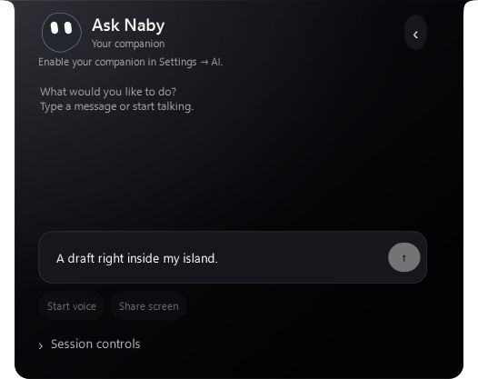
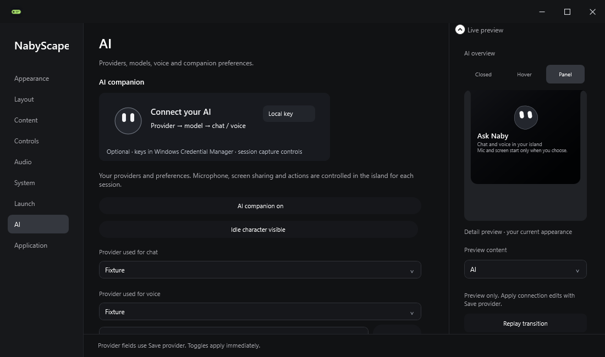

# AI Settings and island cleanup · 2.6.3

AI configuration lives in the main **Settings → AI** category. It includes chat/voice provider selection, connection fields, keys, model capabilities, realtime voice and instructions. Connection details and instructions are grouped into collapsible sections. Provider drafts survive category navigation; closing Settings clears an unsaved key. First-run settings hide empty connection fields until a provider is added. Existing provider definitions and Windows credentials keep their original storage.

The island now focuses on conversation. It has a smaller heading, a message composer with an inline Send button and placeholder, voice/screen controls and a collapsed session-controls section. Stop appears only during active work; Clear appears when there is history. Provider pickers and configuration buttons are removed from chat and the AI hover. A read-only provider name identifies the current conversation.

The closed character's visibility is synchronized whenever island preview state changes. Normal Music hover immediately hides the separate closed character layer, preventing it from floating above artwork or controls. Existing AI hover, closed character interaction and live-session ownership are preserved.

Source: `ffcf800`. Verified standalone Release and local installation: **2.6.3**.

| Check | Result |
| --- | --- |
| Release build | 0 warnings, 0 errors |
| Logic checks | 449 passed, 0 failed |
| Island and embedded Settings WPF checks | 40 passed, 0 failed |
| Companion / Providers WPF checks | 22 passed, 0 failed |
| Character WPF checks | 13 passed, 0 failed |
| Settings visual registry | 50 section titles covered |
| Local upgrade | Running 2.6.3; executable hash matches verified candidate |
| Data / startup | Settings, productivity and provider metadata hashes unchanged; startup value unchanged |

Reports: [logic](evidence/ai-settings-2.6.3/unit-report.txt), [island / Settings](evidence/ai-settings-2.6.3/island-report.txt), [Companion / Providers](evidence/ai-settings-2.6.3/companion-report.txt), [character](evidence/ai-settings-2.6.3/character-report.txt).

Executable and Setup SHA-256: `ade86cb75751ea55600ab6f27e920b626b3d8fb1f434e68f54b46810757fa0a9`. The preceding executable and complete local profile were backed up before installation. Fixture credentials are in memory; installation and verification did not read or change the real credential vault.

## Actual application renders

These captures render the real WPF views in an isolated profile with synthetic conversation/provider data. No daily desktop or real credentials are captured.

## Verification scope

The isolated fixture exercises immediate normal-hover visibility, inline chat without provider controls, main-Settings routing, draft/selection preservation across categories, 1100/600 DIP Settings layouts, synchronized compact-category selection, empty-provider onboarding and unsaved-key cleanup. Existing fixtures cover character motion, responsive chat, action review, drag/tuck interactions and live-session shutdown. All provider, voice and desktop backends are fixtures; no API, microphone, speaker, desktop capture or native input is used.

Live-provider interoperability and physical mixed-DPI/monitor transitions remain outside this UI update's acceptance checks. No new whole-app performance benchmark was taken. This local candidate does not change public GitHub downloads or the website.
