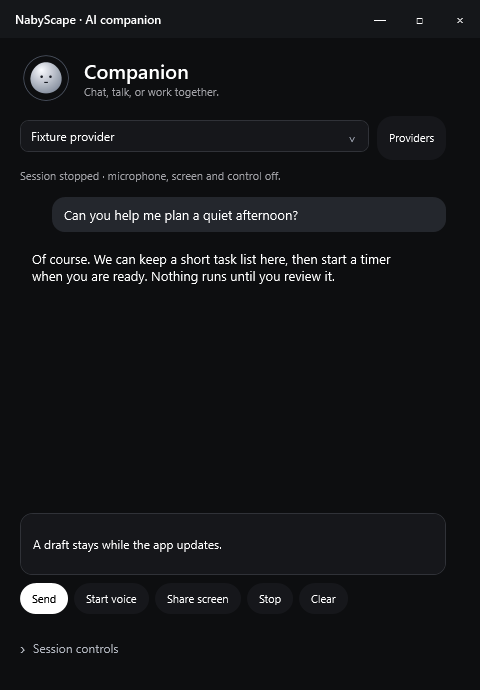
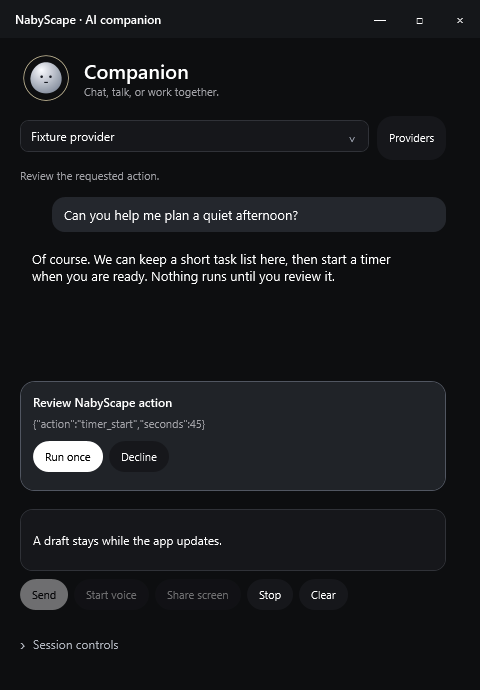
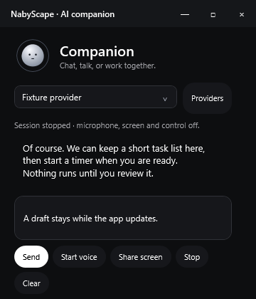
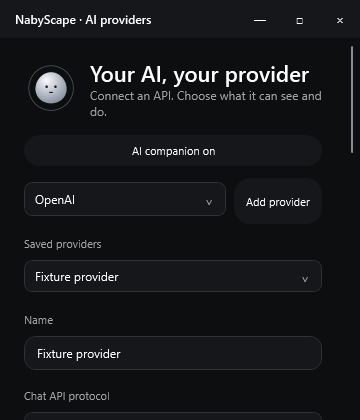

# AI companion · local candidate verification

Build: **2.6.0**, Windows x64, standalone Release. This candidate has not been published as a GitHub release. The daily installation was not used as a test harness.

| Check | Result |
| --- | --- |
| Release build | 0 warnings, 0 errors |
| Standalone logic checks | **432 passed, 0 failed** |
| Provider HTTP fixtures | 15 checks, included above |
| Live voice fake WebSocket/audio fixtures | 23 checks, included above |
| Conversation / credential persistence / desktop backend fixtures | 14 checks, included above |
| Native WPF Companion / Providers diagnostics | **17 passed, 0 failed** |
| Settings scene registry | All 50 actual section titles have dedicated branches |

Commands:

```powershell
./build.ps1 -Dotnet ../tools/dotnet/dotnet.exe -OutputDirectory ./artifacts-assistant-2.6.0
./artifacts-assistant-2.6.0/NabyScape.exe --background --assistant-only --diagnostics ./artifacts-assistant-2.6.0/diagnostics-ai
```

The dedicated diagnostics namespace lets the fixture run beside the daily app without sending its single-instance events or registering its global shortcuts. The profile and credential backend are isolated. No provider API, microphone, speaker playback, desktop screenshot, clipboard data or native input is used by these checks.

Evidence: [logic report](evidence/assistant-2.6.0/unit-report.txt), [WPF report](evidence/assistant-2.6.0/integration-report.txt), [capture methodology](evidence/assistant-2.6.0/capture-notes.txt).

## Actual WPF windows with fixture content

These are rendered application windows with synthetic chat/provider data. The replies are fixtures, not a claim of a successful live-provider connection.

| Companion | Action review |
| --- | --- |
|  |  |

| Compact chat | Compact provider settings |
| --- | --- |
|  |  |

## What was exercised

- Chat tool correlation, protocol metadata replay, bounded turns, unoffered tools, cancellation and late replies. Completed action evidence survives a failed summary without retaining incomplete tool calls.
- Provider timeout/redirect/error/response bounds and all four API payload/parse paths. Replacement credentials are staged under a fresh identity; a failed metadata save preserves the old endpoint/key pairing.
- Voice setup acknowledgements, PCM rates, sustained capture cadence with send latency, long-response buffering, reply-only overflow recovery, interruption, correlated/concurrent tool results and cancellation before/during upload. Started WebSocket frames use session/deadline cancellation so barge-in does not abort the socket.
- Desktop permission gates, fresh-context checks, negative-display coordinate mapping, input schema/key validation, canceled queued captures and setup cleanup using fake backends.
- Real WPF draft/selection preservation, approval/decline/Stop on an isolated timer, static/active/reduced-motion orb subscriptions, accessible captions and compact vertical scrolling. Ten open/close cycles returned runtime subscription counts to baseline.
- Companion at 480 × 690 and 360 × 420 DIP; Providers at 600 × 740 and 360 × 420 DIP. Captures at 1×, 1.5× and 2× render pixel density. These are not OS DPI changes or mixed-monitor emulation.

## Remaining acceptance checks

No credentials were supplied, so actual model access and live OpenAI/Gemini interoperability remain unverified. Real default-input/output behavior, protected/elevated applications, physical mixed-DPI/hotplug, screen capture exclusion and multi-display keyboard targeting need a user-controlled device check. Interruption can retain up to roughly 100 ms of already-queued native audio.

The character stops its render callback when idle, unloaded, hidden or Reduce Motion is enabled. No new whole-app CPU/GPU benchmark or presented-frame trace was taken; the fixture does not establish a performance percentage.
