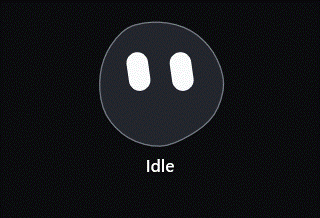
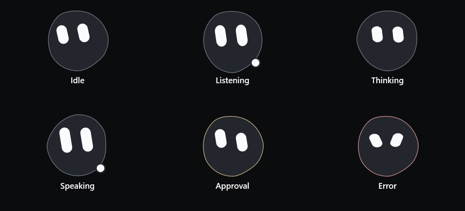
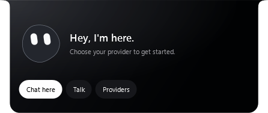

# Interactive character · 2.6.2

The companion now uses a matte blob silhouette and large pill eyes, replacing the metallic face and outer ring. Hover lifts it; pressing squashes it and gives a wink; releasing settles it back. Eyes follow the pointer across the visible island/chat area. Listening, thinking, speaking, approval and error have separate expressions. The existing chat, provider and session controls are preserved.

Source: `f006fc7`. Verified standalone Release and local installation: **2.6.2**.

| Check | Result |
| --- | --- |
| Release build | 0 warnings, 0 errors |
| Logic checks | 449 passed, 0 failed |
| Character WPF fixture | 13 passed, 0 failed |
| Island WPF fixture | 31 passed, 0 failed |
| Companion / Providers WPF fixture | 22 passed, 0 failed |
| Settings scene registry | 50 sections covered |
| GIF decoding | 96 frames; every frame has a 40 ms delay |
| Local upgrade | Running 2.6.2; installed executable matches verified candidate |
| User data | Settings, productivity and provider metadata hashes unchanged; startup value unchanged |

Reports: [logic](evidence/assistant-character-2.6.2/unit-report.txt), [character](evidence/assistant-character-2.6.2/character-report.txt), [island](evidence/assistant-character-2.6.2/island-report.txt), [Companion / Providers](evidence/assistant-character-2.6.2/companion-report.txt).

Executable and Setup SHA-256: `933132146b99b6bf4b9feb8addad4b23b29f23502fba3a8f49e322888776589d`. The preceding executable and full profile were backed up locally before installation. Verification and installation did not read or change the credential vault.

## Actual WPF character

These captures render the real WPF view using synthetic states and audio levels, without a model connection. The looping GIF is sampled at 25 fps; it is a preview format, not a measurement of application frame delivery. The app retains its existing FramePacer and configured frame limit.

## Lifecycle and interaction checks

The controlled character fixture checks bounded/eased pointer tracking, nonfinite-coordinate recovery, press/release, sparse idle blinks without a render callback, active listening, Reduce Motion, global animation disable, hiding/reopening, closing, and absence of microphone/sharing/action side effects. Existing island and Companion/Providers fixtures cover navigation, drafts, drag priority, action review and session shutdown.

Idle blinking uses a timer every 3.3–5.4 seconds; each blink is a short retained animation. Hidden and unloaded characters stop that timer. Active render callbacks exist only for connecting/listening/thinking/speaking, and stop with Reduce Motion or disabled app animation. Pointer and press reactions do not open a provider connection or grant session permissions.

No real API, microphone, speaker, daily desktop capture or native input is used by these fixtures. Live-provider behavior and physical mixed-DPI transitions remain outside this visual update's acceptance checks. No new CPU/GPU benchmark was taken. Public GitHub downloads and the website are unchanged by this local candidate.
