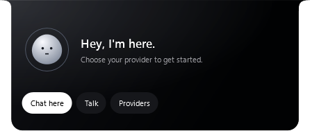
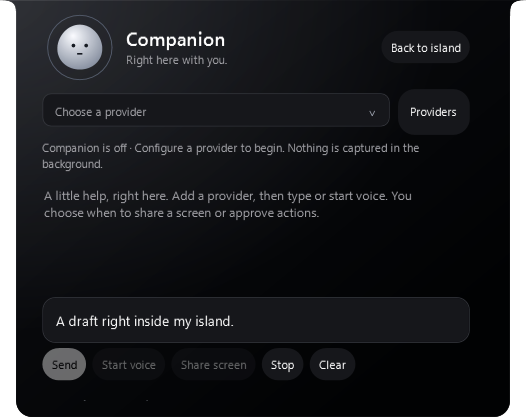
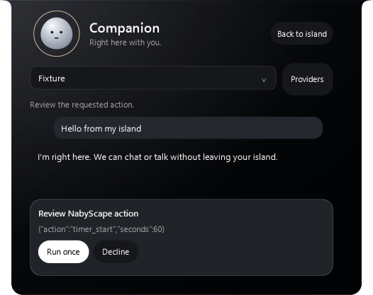

# AI inside the island · local candidate

Version **2.6.1** moves the companion into the existing top island. The small character is a launcher; hovering it never starts a provider request, microphone or screen share. Chat, voice controls and action approval use the same runtime inside the island. Provider configuration remains a separate settings window.

Source: `171f31e`, approved by the final source review. The standalone Release executable was also installed locally after verification. Its SHA-256 matches the verified candidate: `5e03e72b84c9f591249d8b5a59b8e1e490023d1a91967b8941117c85b399c259`.

| Check | Result |
| --- | --- |
| Standalone Release build | 0 warnings, 0 errors |
| Logic checks | 449 passed, 0 failed |
| Island WPF diagnostics | 31 passed, 0 failed |
| Companion / Providers WPF regression checks | 22 passed, 0 failed |
| Settings visual-scene registry | All 50 registered sections covered |
| Local upgrade | Installed 2.6.1; executable hash matched |
| Data and startup | Settings, productivity and provider metadata hashes unchanged; startup value unchanged |

Reports: [logic](evidence/assistant-island-2.6.1/unit-report.txt), [island](evidence/assistant-island-2.6.1/island-report.txt), [Companion / Providers](evidence/assistant-island-2.6.1/companion-report.txt). The previous executable and complete local profile were backed up outside tracked source before installation. The Windows credential vault was not read or changed by the verification or installer.

## Actual application renders

The following captures use synthetic conversation data in an isolated WPF diagnostic profile. They show the real island UI, rather than a design mockup or a successful live-provider conversation.




| Inline chat | Action approval |
| --- | --- |
|  |  |

## Verification method

The dedicated diagnostic instance uses a temporary profile, in-memory credential backend, synthetic voice session and controlled conversation fixtures. Captures render the WPF visual tree. They do not read the daily desktop, credentials or clipboard, play audio, capture a microphone or send native input.

Checks cover hover without capture, inline navigation from short widgets and filtered commands, draft/selection preservation, listener ownership, 360/526 DIP widths, reviewed actions, Back while voice stays live, hidden-orb render cleanup, animation reversal, Reduce Motion, tucked drag priority and retention through an environment heartbeat, canceled/accepted fixture file drops, Escape and the real canceled Window.Closing path. Permanent view disposal is checked immediately and again after deferred WPF events.

```powershell
./build.ps1 -Dotnet ../tools/dotnet/dotnet.exe -OutputDirectory ./artifacts-island-ai-2.6.1-verified
./artifacts-island-ai-2.6.1-verified/NabyScape.exe --background --assistant-only --assistant-island-only --diagnostics ./artifacts-island-ai-2.6.1-verified/diagnostics-island
./artifacts-island-ai-2.6.1-verified/NabyScape.exe --background --assistant-only --diagnostics ./artifacts-island-ai-2.6.1-verified/diagnostics-companion
```

## Limits

No API key was supplied for acceptance testing. Real provider responses, microphone/output devices, live screen sharing, native capture exclusion, physical mixed-DPI transitions and computer actions against external applications remain unverified. Rendered widths exercise responsive layout; they do not simulate an OS DPI or monitor change. No new CPU/GPU benchmark or presented-frame measurement was taken.

The public GitHub release and website are unchanged by this local candidate. See [usage and provider setup](assistant.md).
