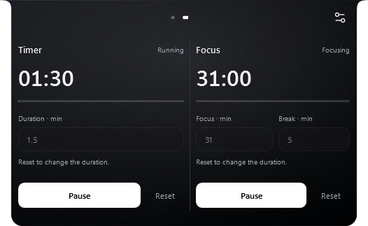
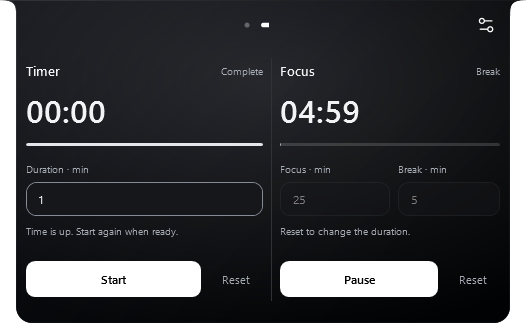

# Timer & Focus UI — 2.7.4

Built, tested and installed locally on 20 October 2026. No GitHub push, public release or website update was performed.

The old countdown interface kept Start beside a separate pause button. Start could therefore restart an already-running session. Both compact and classic layouts now use a shared control with one primary action that follows the session state, and a separate Reset action.

## Actual interface captures

These are WPF captures from an isolated synthetic profile using the final standalone executable.

| Ready | Running |
|---|---|
|  |  |

| Paused | Focus break |
|---|---|
|  |  |

The existing two-column layout and narrow-panel stacking remain. Time displays use tabular numerals, controls align across columns, and session progress has a thin track. Active or paused sessions lock their duration fields; Reset restores editing. Input errors stay inline, and valid drafts and selection survive updates.

## Verification

- **466 logic checks passed.** [Report](evidence/countdown-ui-2.7.4/logic-report.txt).
- **35 countdown UI checks passed:** Start/Pause/Resume, session identity and duration preservation, reset, invalid input, text selection, completion, automatic focus breaks, shared heartbeat lifecycle, unrelated-update filtering, progress, externally started timers, 300/526 DIP layouts, and classic controls. [Report](evidence/countdown-ui-2.7.4/countdown-report.txt).
- **44 related UI checks passed:** 29 Media/Focus/Settings checks and 15 clipboard/lyrics checks. [Media report](evidence/countdown-ui-2.7.4/media-report.txt) · [Scroll/lyrics report](evidence/countdown-ui-2.7.4/scroll-report.txt).
- All 53 Settings scene registrations passed. The clean Release build, standalone packaging, portable contents, notices, SHA-256 checksums and WinGet fixture validation passed.
- The installed application reports **2.7.4.0**, is running, and matches the tested installer payload. All preferences, startup registration, Notes/Tasks/Shelf, assistant configuration and calendar fingerprints were preserved. A private local backup was made before installation. [Sanitized installation result](evidence/countdown-ui-2.7.4/installation.json).

The completion fixture initially used a one-second timer, below the UI's six-second minimum. Its retained duration correctly prevented a later Start; the fixture was corrected to a valid one-minute timer before rerunning the complete UI suite.

No new timer or continuous render loop was added. Hidden countdown views unsubscribe, and visible controls ignore unrelated media/audio changes. Deadline, sleep/resume and notification/sound logic were not changed.

## Limits

[150%](evidence/countdown-ui-2.7.4/running-150.png) and [200%](evidence/countdown-ui-2.7.4/running-200.png) are scaled WPF raster exports, rather than physical monitor DPI tests. On [narrow panels](evidence/countdown-ui-2.7.4/ready-300.png), longer content uses the existing outer scroll viewport. Performance percentages were not benchmarked for this UI change. Fixtures disable completion sounds and notification delivery and do not use personal clipboard content or AI provider keys.
