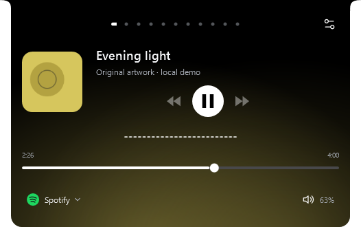
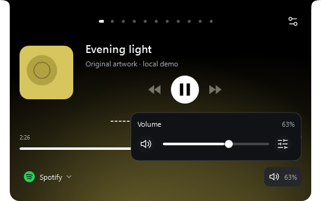
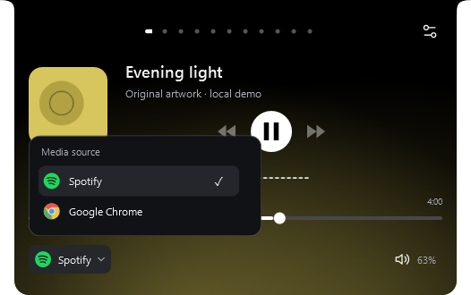

# Compact media controls — 2.7.8

This implements the approved second concept: a content-sized source button on the left and a speaker/percentage button on the right. Both open bounded overlays inside the music surface. Transport, seek, waveform, lyrics and ambient settings remain intact.

## Actual WPF captures

| Default | Volume | Media source |
| --- | --- | --- |
|  |  |  |

[Original Windows slider integration](evidence/media-footer-2.7.8/media-volume-integrated.png) · [300 DIP dock](evidence/media-footer-2.7.8/media-volume-300.png).

The captures use original fixture artwork and title. Spotify and Chrome enumeration and the screenshot slider are injected deterministic data. The integration case verifies that the real shared Windows slider, mute, mixer and device/microphone buttons are mounted without changing Windows audio. No playback command, device switch, volume write, provider request, microphone or screen sharing is performed by this fixture.

## Verification

| Check | Passed | Failed |
| --- | ---: | ---: |
| Logic | 484 | 0 |
| Media footer integration, lifecycle and bounds | 33 | 0 |
| Seven minimal widgets | 47 | 0 |
| Clipboard scroll and lyrics | 15 | 0 |
| Media experience | 29 | 0 |
| Reactive ambient | 37 | 0 |
| Classic mixer routing | 6 | 0 |
| Settings layout matrix | 314 | 0 |

The footer cases exercise source selection, stale session dismissal, empty states, 300/526 DIP widths, internal scrolling, wheel isolation from widget navigation, mutual exclusion, Escape, coalesced outside-click dismissal, cleanup on page change/collapse, volume-only and media-only configurations, classic inline volume, finite transitions and Reduce Motion. Source enumeration refreshes on media/settings changes; audio updates retain the footer icons.

The Canvas overlay contributes no desired size to the dock. No private timer or continuous rendering subscription was added. Physical mixed-DPI monitor movement, sustained GPU frame pacing and live hardware volume/device routing remain manual checks.

The release builder verifies the Settings illustration registry, self-contained Windows x64 installer/portable contents and licenses, three SHA-256 hashes and the generated WinGet installer hash. Local packages: `release-output/media-footer-2.7.8-local/`. Private profiles and upgrade backups stay in ignored `outputs/`. This update has not been published to GitHub.

The self-contained build repeated all 33 footer checks and 15 clipboard/lyrics checks successfully. Local upgrade verification confirmed 2.7.8.0 running with an exact payload match, every existing preference value preserved, unchanged startup entries, unchanged Notes/Tasks/shelf content, and unchanged assistant/calendar configuration. The previous executable and data were backed up before installation. Provider credentials remain local and are excluded from packages and evidence.
