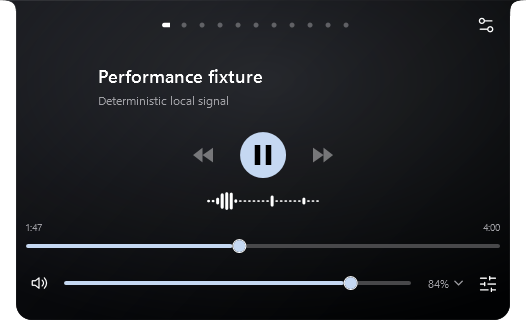

# NabyScape 2.7.0 · media and everyday interaction

Historical local Windows candidate, checked on 20 October 2026. These changes ship in v2.7.2 alongside the [compact waveform follow-up](verification-closed-waveform-2.7.1.md) and [clipboard/side-lyrics fixes](verification-scroll-lyrics-2.7.2.md). Counts and captures below describe the original 2.7.0 candidate; the final release has 466 passing logic checks.

## Find the new controls

| Change | Where to use it |
| --- | --- |
| Minimal navigation dots | Settings → Appearance → Text and navigation → Category appearance → **Dots**. Names remain available on hover and keyboard focus. Ctrl+Tab switches panels; navigation scrolls when there are many panels. |
| Simpler companion | Open Naby from its island character. Voice and sharing are in the composer; the header holds Clear, AI Settings and Back. **Permissions** contains action and selected-display controls. Enter sends, Shift+Enter adds a line, Escape stops or returns. |
| Synced Spotify lyrics | Settings → Audio → **Lyrics**, or the lyrics icon at the right of the Music playback controls. Choose **Slide**, **Focus** or **Karaoke**, adjust timing by ±10 seconds, and try the animated sample in Settings. |
| Real audio spectrum | Settings → Audio → **Visualizer**. Frequency spectrum is the default; Amplitude history remains available. Sensitivity ranges from 0.5× to 3×. |
| Individual tools | Settings → Content → **Enabled widgets & order**. Shelf, Notes, Tasks, Clipboard, Calendar, Keep awake and Clean links each have a panel. Legacy tool ordering and disabled states migrate in place; existing documents are preserved. Main panels and hover pages remain independently configurable. |
| Direct movement and resizing | Settings → Layout → **Move & resize**, the tray menu, or the closed island's context menu. The top grip moves the island; lower corners resize the current state. Arrow keys adjust a focused grip, and Escape cancels a drag. Dragging a notch downward detaches it into a pill. |
| Fixed or automatic panel height | Settings → Layout → Open panel → **Fit panel height to content**. Resizing a panel vertically switches to a fixed height, including when the content is shorter. Closed, hover and panel sizes remain independent. |
| Editable Focus | Edit Focus and Break minutes directly in the Focus panel, or use Settings → Content → Focus sessions. New values apply to the next session. |
| Audible completion | Settings → Application → **Completion sound**. Chime, Bell, a local WAV, or Off; separate volume and a preview button. Timer and Focus play directly through Windows output when their per-type notice is enabled. |
| Optional browser previews | Settings → Controls → Automatic activity → **Automatic browser media previews**. Off suppresses automatic browser and opaque Windows media identities, including YouTube hover-playback sessions. Manual island hover and playback controls remain available. |

## Lyrics and audio boundaries

Automatic lyrics are opt-in. Visible Spotify lyrics send track title, artist and duration to [LRCLIB's documented lookup API](https://lrclib.net/docs), without cookies, Spotify credentials or an AI key. Responses are bounded and cached only in memory, with cancellation on track changes. Missing timings stay labeled unavailable. A direct lookup during this work returned **HTTP 503**; automatic lyrics therefore could not be verified against that live track. **Retry** and **Local LRC…** are available. Local LRC imports also remain in memory for the app session.

Karaoke uses line timings and a smooth line sweep. It does not claim word timestamps. Reduce Motion and disabled Windows animation keep text transitions static while still updating the current line. Preview timers stop outside the scroll viewport, when minimized, or when unloaded.

The spectrum uses the existing NAudio dependency and WASAPI output loopback, not microphone input. A 2048-sample Hann-windowed FFT produces 25 logarithmic bands at at most 30 updates per second. Each matching output has one shared capture; additional island or Settings consumers read the same snapshot. Muting the selected app/output gates the display. Samples are never written to disk, and capture expires after visual demand ends.

Output loopback includes other apps sharing that output; it is not per-process frequency isolation. **Amplitude history** continues to read the selected app's own level and serves as the unavailable-device fallback. No synthetic frequency bands are presented as measured audio. [NAudio output-capture documentation](https://github.com/naudio/NAudio/blob/main/Docs/WasapiLoopbackCapture.md).

Completion sounds use the current output independently of Windows notification delivery. Custom WAVs are limited to 10 MB and 15 seconds; an unavailable custom sound falls back to the chime. Local sound paths are excluded from layout exports.

## Verification

- **461 logic checks passed**, including legacy tool migration, independent hover visibility, layout import, browser/opaque identity policy, LRC offsets and Unicode, offline/retry/stale-response handling, FFT frequency separation, fast independent attack/release and geometry bounds.
- **28 focused UI checks passed**, including manual panel height, named resize grips, shared Notes data, editable Focus, symmetric Media insets, draft/selection preservation, lyric transitions, preview viewport/minimize behavior and independent hover sizing.
- **45 existing AI island checks passed** for the shared runtime, transitions, closed interaction and permission/session behavior.
- A quiet owned chime was played on the real Windows output. The app's audio session was resolved and the loopback produced nonzero measured FFT bands. A separate test verified that capture stopped after its last visual consumer disappeared.
- Release packaging independently recomputed all three asset hashes, verified portable/notices contents and checked the generated WinGet installer hash.
- The portable archive contains exactly the executable and five license/notices files. No user configuration is packaged; API keys remain in Windows Credential Manager. A common credential-pattern scan of source and presets found no matching files.

The build creates a standalone installer, portable ZIP, notices ZIP, SHA256SUMS and a WinGet manifest fixture. It adds no application dependency and does not change the framework or provider protocols.

The final local package was installed and relaunched successfully as **2.7.0.0**. The installed payload hash matches the packaged executable. Startup registration, Notes/Tasks/Shelf, calendar and saved AI provider metadata were verified unchanged after the upgrade; a local pre-upgrade backup was created. [Sanitized upgrade result](evidence/media-ux-2.7.0/upgrade-report.json).

## Actual WPF previews

All note, conversation and lyric text shown here is original sample content. Spectrum illustration captures use a deterministic mixture of sine signals; no song audio is recorded.





Captures use WPF RenderTargetBitmap, including 100%, 150% and 200% rendering scales at 300 and 526 DIP panel widths. They do not establish physical mixed-DPI dragging, monitor hotplug, GPU-presented FPS or a controlled CPU/RAM comparison. Actual native dragging across mixed-DPI hardware remains a manual verification limit. Live AI provider billing and real microphone/screen sessions were not exercised by these UI checks.

## Reproduce locally

```powershell
./tools/Build-Release.ps1 -Tag v2.7.0 -Dotnet ../tools/dotnet/dotnet.exe -OutputDirectory <new-output-folder>
./<new-output-folder>/publish/NabyScape.exe --diagnostics <new-diagnostic-folder> --assistant-only --media-ux-only
```

Add `--media-ux-sound-probe` only when an audible low-volume test chime is appropriate. Diagnostics use a separate local profile and fixture provider; they do not read a saved API key, send a chat request or execute desktop actions.
