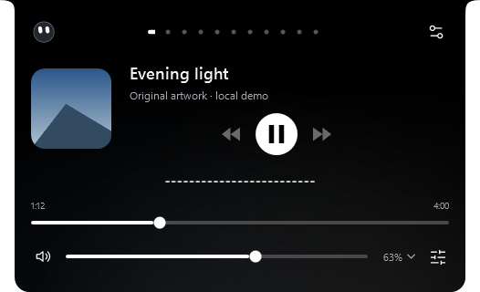
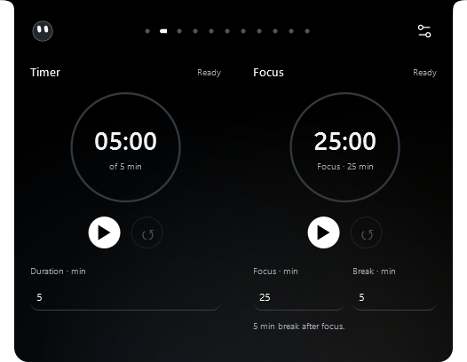
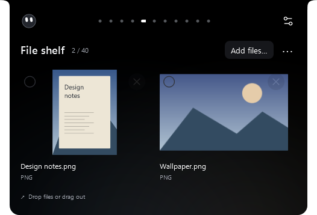
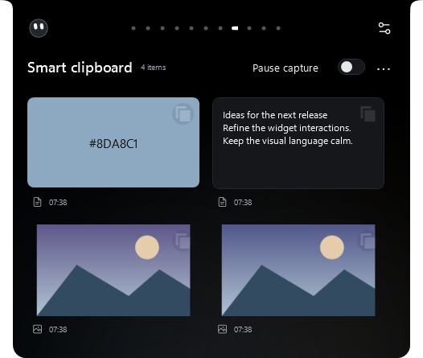
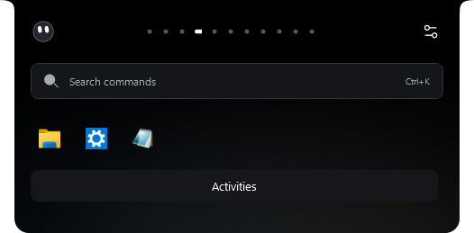
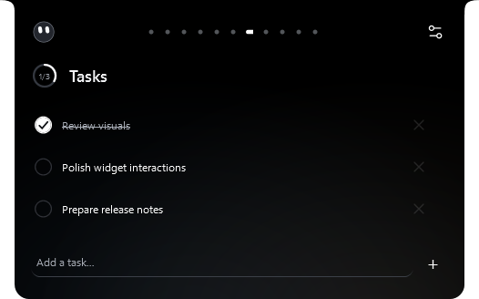
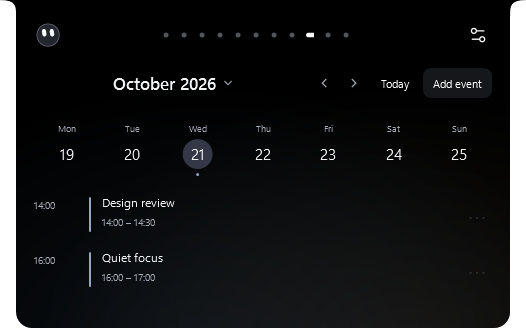

# Minimal widget refinement — 2.7.7

The approved visual direction refines the existing compact island. It retains dot/icon/text navigation, the AI face, audio sampling, ambient settings and personal data formats.

## Actual WPF renders

These captures use original generated fixture artwork and synthetic local files, tasks, events and clipboard items. They contain no personal profile or provider credentials.

| Music | Timer and Focus |
| --- | --- |
|  |  |

| File shelf | Clipboard |
| --- | --- |
|  |  |

| Launch | Tasks | Calendar |
| --- | --- | --- |
|  |  |  |

## Verification

| Check | Passed | Failed |
| --- | ---: | ---: |
| Logic | 484 | 0 |
| Seven widgets, narrow layouts, menus and thumbnail lifetime | 47 | 0 |
| Countdown state and controls | 35 | 0 |
| Clipboard scroll and lyrics | 15 | 0 |
| Media controls | 28 | 0 |
| Reactive ambient | 37 | 0 |
| Premium interactions and notifications | 32 | 0 |
| AI island and settings | 45 | 0 |
| Settings layout matrix | 314 | 0 |

The new checks cover 300 and 526 DIP widths, real bottom insets, selector visibility, state-driven countdown actions, saved task completion, draft selection retention, accessible menus, clipboard details, viewport-bounded image loading and texture release. The clipboard regression suite checks internal scrolling rather than scrolling the whole panel.

The release builder verifies all 55 Settings illustration branches, archive contents and notices, three independently recomputed SHA-256 checksums and the generated WinGet installer hash. Installer and portable builds are self-contained Windows x64 packages.

No recurring timer or rendering subscription was added for rings, galleries or menus. Rings use finite value transitions; the existing shared countdown heartbeat remains attached only while visible. These checks do not establish a CPU/GPU performance improvement or long-duration memory benchmark.

150% and 200% captures are raster exports. Physical mixed-DPI monitor changes and sustained GPU frame pacing remain manual checks. Shell thumbnails use the installed Windows provider, with a file icon fallback where unavailable.

Local packages are in `release-output/minimal-widgets-2.7.7-local/`. Private upgrade backups and isolated test profiles stay in ignored `outputs/`. This change has not been published to GitHub.

Local upgrade verification confirmed version 2.7.7.0 running, an exact installer payload match, all existing preference values preserved, unchanged Windows startup entries, unchanged Notes/Tasks/shelf content, and unchanged assistant and calendar configuration. A private backup of the previous executable and data was taken before installation. No provider credentials are included in the evidence or release packages.
