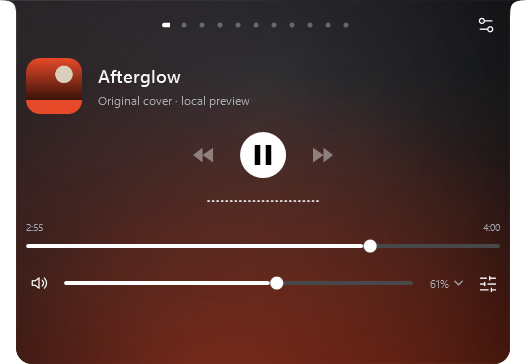
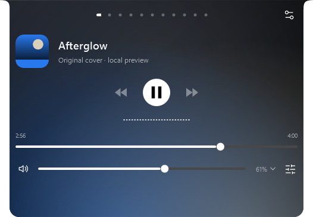
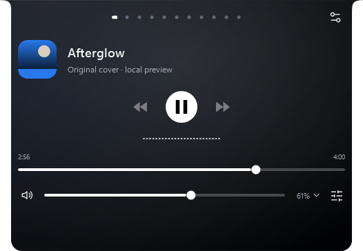
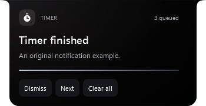

# Premium experience — 2.7.5

Built, verified and installed locally on 21 October 2026. No GitHub push, tag, public release or website deployment was performed.

## Interface evidence

Actual WPF captures use original drawn covers and synthetic notifications in isolated profiles. Personal provider keys, messages and clipboard content are excluded.

| Warm cover | Cool cover |
|---|---|
|  |  |

| Ambient off | Notification details |
|---|---|
|  |  |

Appearance contains a dedicated ambient example, intensity/spread controls and Still/Breathe/Drift. Motion provides Off/Subtle/Expressive interaction feedback. Application contains notification entrance styles, lifetime, preview, quiet hours and snooze. The original nine Settings categories and navigation remain.

## Automated verification

**473 logic checks passed**, including seven new checks for normalization, quiet-hour boundaries, snooze delivery, notification lifetime, layout export privacy, Hermes defaults and HTTP session continuity. [Logic report](evidence/premium-experience-2.7.5/logic-report.txt).

**474 UI checks passed on the final standalone executable:**

| Suite | Passed | Evidence |
|---|---:|---|
| Ambient, interaction, Hermes Settings and notification presentation | 32 | [Report](evidence/premium-experience-2.7.5/premium-experience-report.txt) |
| Notification/download routes, original-file handoff, tuck/hide and editor preservation | 32 | [Report](evidence/premium-experience-2.7.5/premium-notifications-report.txt) |
| Timer/Focus state transitions and responsive controls | 35 | [Report](evidence/premium-experience-2.7.5/countdown-panel-report.txt) |
| Related media and AI composer behavior | 29 | [Report](evidence/premium-experience-2.7.5/media-ux-report.txt) |
| Clipboard scrolling and lyric layout | 15 | [Report](evidence/premium-experience-2.7.5/scroll-lyrics-report.txt) |
| Settings sizing and layout matrix | 314 | [Report](evidence/premium-experience-2.7.5/visual-polish-matrix-report.txt) |
| Naby character and island interaction regression | 17 | [Report](evidence/premium-experience-2.7.5/assistant-character-report.txt) |

The final Media run included its conditional measured-live-audio check when a playing source was available. The character regression suite additionally verified the existing Naby interactions after hiding the closed companion during notification details.

All **55 Settings scene registrations** passed. The clean Release build, standalone installer, portable/notices archives, SHA-256 hashes and WinGet fixture passed package validation. The installed **2.7.5.0** process is running and matches the tested payload. Existing preference values, startup registration, Notes/Tasks/Shelf, assistant configuration and calendar fingerprints were preserved; new preference fields use their defaults. A private local backup was created before installation. [Sanitized installation verification](evidence/premium-experience-2.7.5/installation.json).

## Implementation and limits

Cover extraction renders at 32×32 once per artwork reference. Ambient animation uses retained WPF brush clocks, rather than a new polling timer or managed rendering subscription, and follows the performance frame limit. Pause, tuck, manual hide, non-media surfaces and Reduce motion stop the relevant clocks. Interaction animations are finite and do not rebuild editors.

Notification expiry uses the existing heartbeat. Quiet hours use Windows local time; snooze uses an absolute timestamp. Open notification interactions pause expiry, while an explicit preview remains available during snooze. The temporary queue remains bounded to ten entries. Download actions retain their original paths and do not move files automatically.

Hermes fixtures verify Chat Completions routing, Bearer authentication, isolated session headers, fresh request admission keys and Clear behavior. **A real Hermes gateway, backend tools and live voice were not exercised.** Hermes manages its own tools and memory; Naby cancellation only cancels its request. [Setup and backend boundaries](hermes-agent.md).

An older standalone Assistant-window fixture still expects a removed “Session controls” expander; that stale fixture is not included in the passing counts. Its earlier action approval checks passed before that lookup. The new Hermes/provider UI and HTTP checks use the current Settings interface.

[150%](evidence/premium-experience-2.7.5/ambient-cool-150.png) and [200%](evidence/premium-experience-2.7.5/ambient-cool-200.png) images are WPF raster exports, rather than physical mixed-DPI monitor tests. [Narrow capture](evidence/premium-experience-2.7.5/ambient-narrow.png). No CPU/GPU savings percentage or frame-presentation benchmark is claimed for this change.
