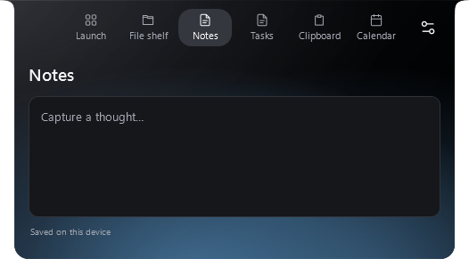
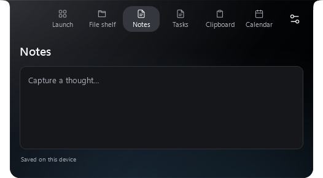
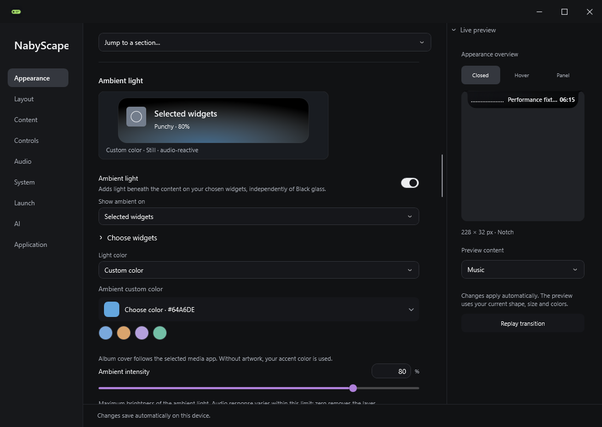
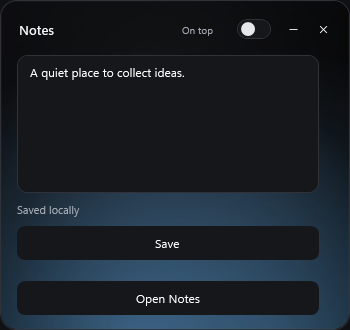

# Reactive ambient — 2.7.6

Built, verified and installed locally on 21 October 2026. The installed executable matches the final installer payload. Existing preferences, startup registration, Notes/Tasks/shelf, calendar and AI configuration were preserved and backed up before installation. No public release or website deployment was performed.

## Interface evidence

Captures come from the actual WPF application with synthetic notes and measured-level fixtures in an isolated profile. They contain no personal conversations, provider credentials or clipboard history.

| Strong measured audio | Silence / quiet floor |
|---|---|
|  |  |

| Widget scope and color | Detached Notes |
|---|---|
|  |  |

[Audio response controls](evidence/reactive-ambient-2.7.6/settings-audio-response.png) · [150% raster export](evidence/reactive-ambient-2.7.6/notes-audio-high-150.png) · [200% raster export](evidence/reactive-ambient-2.7.6/notes-audio-high-200.png).

## Checks on the final standalone binary

| Suite | Passed | Failed |
|---|---:|---:|
| [Logic](evidence/reactive-ambient-2.7.6/logic-report.txt) | 480 | 0 |
| [Reactive ambient](evidence/reactive-ambient-2.7.6/reactive-ambient-report.txt) | 37 | 0 |
| [Previous premium interactions / notifications / provider UI](evidence/reactive-ambient-2.7.6/premium-experience-report.txt) | 32 | 0 |
| [Clipboard scroll and lyrics](evidence/reactive-ambient-2.7.6/scroll-lyrics-report.txt) | 15 | 0 |
| [Timer / Focus](evidence/reactive-ambient-2.7.6/countdown-panel-report.txt) | 35 | 0 |
| [Media controls](evidence/reactive-ambient-2.7.6/media-ux-report.txt) | 29 | 0 |
| [Settings layout matrix](evidence/reactive-ambient-2.7.6/visual-polish-matrix-report.txt) | 314 | 0 |

Release checks also verified all 55 Settings illustration branches, SHA-256 checksums for all three assets, portable/notice archive contents and the generated WinGet setup hash. Installer and portable packages are self-contained Windows x64 builds.

The new cases exercise all widget pages, immediate scope changes in hover, actual quiet/loud input, silence decay, fallback and custom colors, stable text selection and control identity, two additional mini windows, 20 repeated mini-window cycles, release of registered surfaces, pause/tuck/hide, Reduce motion and the master switches. Logic checks cover normalization, scope, color fallback, response profiles, sensitivity, export/import, and an ambient-first / waveform-second shared audio lease.

## Sampling and limits

The shared timer targets 30 Hz. AudioService retains its 30 Hz sample gate across ambient, waveform and Settings consumers. In the final [sampling fixture](evidence/reactive-ambient-2.7.6/sampling.txt), three ambient consumers caused **20 shared meter reads in 1.001 seconds**; dispatcher scheduling means the target is not a guaranteed callback frequency. Ambient-only Notes and System made no spectrum requests or output captures. Hidden and tucked checks verified that ambient sampling stops; hidden checks also verified no additional meter reads.

Brightness updates use retained WPF drawing resources, independent of Breathe/Drift brush clocks. The fixture verifies behavior and resource demand, not presented GPU frames, a CPU/GPU savings percentage, or long-duration memory stability. The 1.5× and 2× captures are raster exports rather than physical mixed-DPI monitor tests. Real-device routing and visual smoothness under sustained GPU load remain manual checks.

Local packages: `release-output/reactive-ambient-2.7.6-final/`. Private backups and diagnostic profiles remain in ignored `outputs/`; only synthetic images and reports are included here.
