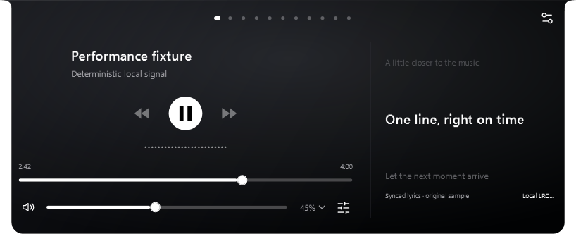
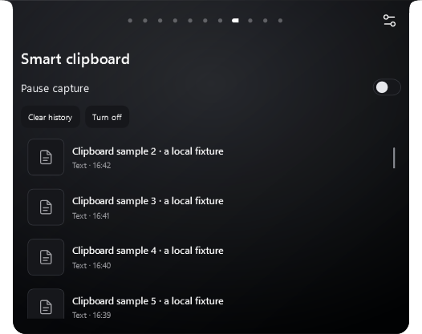

# Clipboard scrolling and side lyrics — 2.7.2

Clipboard history previously shared the outer panel's scroll viewport. Overflow stopped wheel navigation, and scrolling moved the heading and panel navigation with the list.

- The clipboard list and item details now have a bounded inner viewport. The heading, capture toggle, actions and navigation remain outside it.
- Vertical wheel input over the list stays within it, including at either edge. Fast wheel/trackpad deltas accumulate before layout. Returning to the page restores its history position.
- Wheel input over the navigation changes panels. Horizontal gestures can leave the list; note editors retain their normal vertical scrolling.
- The list budget accounts for panel scale, navigation and controls. It remeasures when the panel or working area changes.

Showing lyrics now opens a dedicated right column alongside the music player. The contour expands using the existing animation; hiding lyrics restores the saved panel width without changing that preference. A constrained working area uses a stacked layout. The existing lyric source, three animation presets, privacy choice and lookup lifecycle remain unchanged.

## Verification

- Release compilation: no warnings or errors.
- Logic checks: 466 passed, including bounded lyric width and scaled narrow-layout cases.
- Focused UI checks: 15 passed. WPF routed wheel events cover list scrolling, fast deltas, navigation, boundaries, history retention and Notes; layout checks cover 300/526 DIP panels, a short 300 DIP panel, side lyrics and width restoration.
- Related media/UI regression checks: 29 passed, including editor selection, focus duration, dock resizing, three lyric animations, preview visibility and assistant draft preservation.
- Final installer and portable package passed checksum and content validation. Local 2.7.2 installation is running with the exact verified payload. A backup was created; startup, notes/tasks/shelf, assistant configuration and calendar checks passed. Saved panel geometry remains unchanged. Post-launch clipboard capture rotated the oldest unpinned item at the existing 30-item limit; the other 29 original entries remain, and the complete prior history is in the backup. The lyrics preference was toggled after launch; live user changes were retained.
- Screenshots use synthetic clipboard data and original lyric samples. Scale captures are offscreen WPF renderings at 100/150/200%, not physical monitor relocation or GPU frame measurements. The fixture checks do not read/write the system clipboard or contact an AI provider.

[Focused UI report](evidence/scroll-lyrics-2.7.2/integration-report.txt) · [Related UI report](evidence/scroll-lyrics-2.7.2/media-regression-report.txt)

[Logic report](evidence/scroll-lyrics-2.7.2/logic-report.txt) · [Local upgrade verification](evidence/scroll-lyrics-2.7.2/upgrade-report.json)
