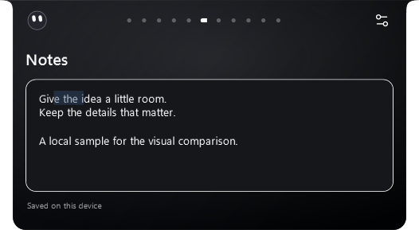
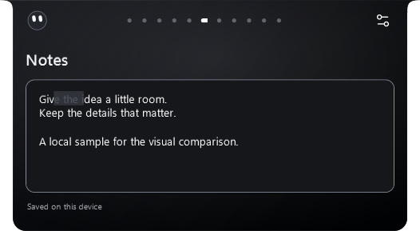
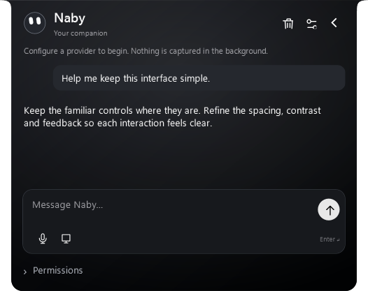
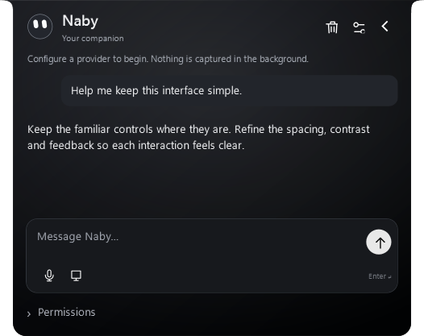
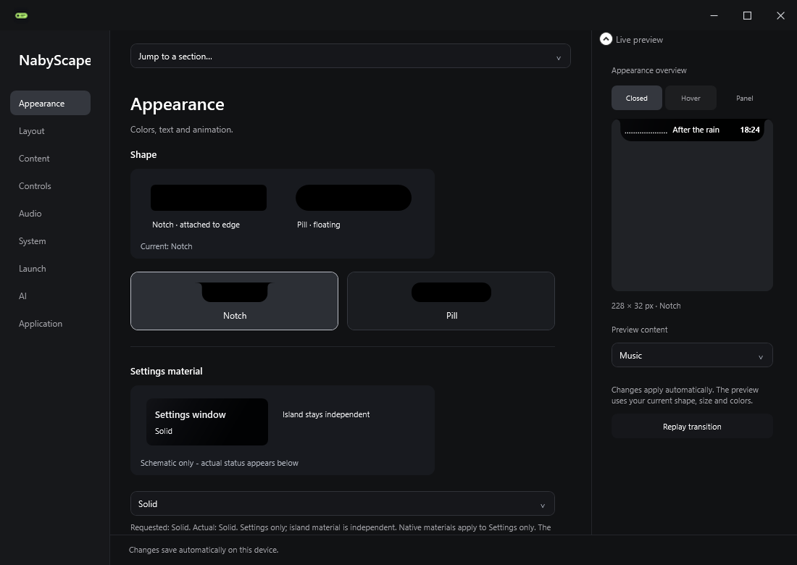
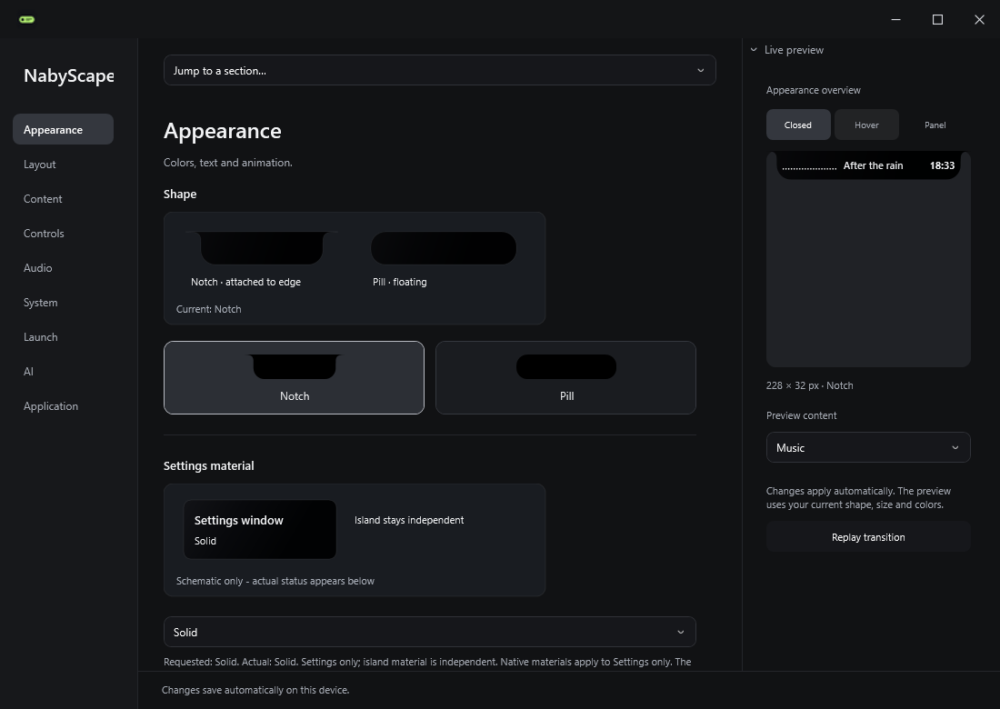
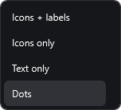
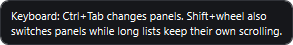

# Visual polish — 2.7.3

Local build installed and verified on 20 October 2026. No GitHub push, tag, public release or website change was performed. Public downloads remain on 2.7.2.

This is a visual refinement of the existing interface. Its widget groups, dot/icon/text navigation, nine Settings categories, component positions, saved preferences and interaction flow are retained. There is no Named picker or category regrouping.

## Before and after

These are actual WPF offscreen captures using synthetic notes, tasks, clipboard, conversation and an original abstract cover drawing. They contain no private provider keys or personal profile content. Time and media progress can differ between runs.

| Before | Refined |
|---|---|
|  |  |
|  |  |
|  |  |

The field outline is calmer while editing. Hover/press feedback retains text contrast, dropdown text stays fully readable when focused, and keyboard focus remains available. Neutral text tones and clearer primary labels refine the hierarchy. Naby uses more readable message leading in the same conversation/composer layout.

Dropdown and expandable-section chevrons are vector paths. Tooltips use the app's dark surface and wrap longer keyboard hints. Settings illustrations have finer edges and use the actual notch contour; their positions and existing examples remain.

## All existing widget groups

| Page | Before | After |
|---|---|---|
| Music & volume | [526 DIP](evidence/visual-polish-2.7.3/before/media-526.png) · [300 DIP](evidence/visual-polish-2.7.3/before/media-300.png) | [526 DIP](evidence/visual-polish-2.7.3/after/media-526.png) · [300 DIP](evidence/visual-polish-2.7.3/after/media-300.png) |
| Timer, Stopwatch & Focus | [526 DIP](evidence/visual-polish-2.7.3/before/focus-526.png) · [300 DIP](evidence/visual-polish-2.7.3/before/focus-300.png) | [526 DIP](evidence/visual-polish-2.7.3/after/focus-526.png) · [300 DIP](evidence/visual-polish-2.7.3/after/focus-300.png) |
| Clock, System & battery | [526 DIP](evidence/visual-polish-2.7.3/before/status-526.png) · [300 DIP](evidence/visual-polish-2.7.3/before/status-300.png) | [526 DIP](evidence/visual-polish-2.7.3/after/status-526.png) · [300 DIP](evidence/visual-polish-2.7.3/after/status-300.png) |
| Shortcuts | [526 DIP](evidence/visual-polish-2.7.3/before/access-526.png) · [300 DIP](evidence/visual-polish-2.7.3/before/access-300.png) | [526 DIP](evidence/visual-polish-2.7.3/after/access-526.png) · [300 DIP](evidence/visual-polish-2.7.3/after/access-300.png) |
| Shelf | [526 DIP](evidence/visual-polish-2.7.3/before/files-526.png) · [300 DIP](evidence/visual-polish-2.7.3/before/files-300.png) | [526 DIP](evidence/visual-polish-2.7.3/after/files-526.png) · [300 DIP](evidence/visual-polish-2.7.3/after/files-300.png) |
| Notes | [526 DIP](evidence/visual-polish-2.7.3/before/notes-526.png) · [300 DIP](evidence/visual-polish-2.7.3/before/notes-300.png) | [526 DIP](evidence/visual-polish-2.7.3/after/notes-526.png) · [300 DIP](evidence/visual-polish-2.7.3/after/notes-300.png) |
| Tasks | [526 DIP](evidence/visual-polish-2.7.3/before/tasks-526.png) · [300 DIP](evidence/visual-polish-2.7.3/before/tasks-300.png) | [526 DIP](evidence/visual-polish-2.7.3/after/tasks-526.png) · [300 DIP](evidence/visual-polish-2.7.3/after/tasks-300.png) |
| Clipboard | [526 DIP](evidence/visual-polish-2.7.3/before/clips-526.png) · [300 DIP](evidence/visual-polish-2.7.3/before/clips-300.png) | [526 DIP](evidence/visual-polish-2.7.3/after/clips-526.png) · [300 DIP](evidence/visual-polish-2.7.3/after/clips-300.png) |
| Calendar | [526 DIP](evidence/visual-polish-2.7.3/before/calendar-526.png) · [300 DIP](evidence/visual-polish-2.7.3/before/calendar-300.png) | [526 DIP](evidence/visual-polish-2.7.3/after/calendar-526.png) · [300 DIP](evidence/visual-polish-2.7.3/after/calendar-300.png) |
| Keep awake | [526 DIP](evidence/visual-polish-2.7.3/before/awake-526.png) · [300 DIP](evidence/visual-polish-2.7.3/before/awake-300.png) | [526 DIP](evidence/visual-polish-2.7.3/after/awake-526.png) · [300 DIP](evidence/visual-polish-2.7.3/after/awake-300.png) |
| Clean links | [526 DIP](evidence/visual-polish-2.7.3/before/links-526.png) · [300 DIP](evidence/visual-polish-2.7.3/before/links-300.png) | [526 DIP](evidence/visual-polish-2.7.3/after/links-526.png) · [300 DIP](evidence/visual-polish-2.7.3/after/links-300.png) |

## Verification

- **466 logic checks passed**, plus all 53 Settings scene registrations. [Logic report](evidence/visual-polish-2.7.3/logic-report.txt).
- **387 UI checks passed**: 29 visual/structure/input checks, 314 Settings matrix checks, 29 related media checks and 15 clipboard/lyrics checks. [Visual](evidence/visual-polish-2.7.3/visual-report.txt) · [Settings](evidence/visual-polish-2.7.3/settings-report.txt) · [Media](evidence/visual-polish-2.7.3/media-report.txt) · [Scroll](evidence/visual-polish-2.7.3/scroll-report.txt).
- The final standalone package produced the visual and Settings reports. The related media/scroll checks ran on the same source in the Release SDK build.
- **412 named island control bounds match the original interface exactly**, across 300 and 526 DIP. [Comparison](evidence/visual-polish-2.7.3/geometry-comparison.json). This measures control layout; typography and paint deliberately differ.
- Notes keeps its original 136 DIP editor height, correct caret inset, focus and selection. The existing grouped pages and all nine Settings categories remain in order.
- Settings was tested at simulated 1024×600, 1280×720, 1366×768 and 1920×1080, each at 100%, 150% and 200% DPI, subtracting 48 DIP for the taskbar. Controls fit and remained reachable.
- Installer/portable packaging, all five notices, three SHA-256 hashes and WinGet fixture checks passed. [Checksums](evidence/visual-polish-2.7.3/SHA256SUMS).

## Installed locally

Version **2.7.3.0** is running and matches the installer payload. All preferences, startup registry values, Notes/Tasks/Shelf, assistant configuration and calendar passed preservation checks. A local binary/data backup was created first; backup contents are ignored by Git and excluded from packages. [Sanitized upgrade result](evidence/visual-polish-2.7.3/upgrade-report.json).

## Limits

The DPI matrix uses synthetic logical viewports and raster exports; it does not replace physical mixed-DPI/hot-plug testing. No controlled CPU/GPU benchmark or GPU presentation trace was collected for this styling update. No continuous render loop, dependency, sampling change or island animation timing was added. Live voice/provider/screen sessions were not exercised with private credentials. The images demonstrate paint/layout and fixture interactions, rather than a new marketing mockup.
